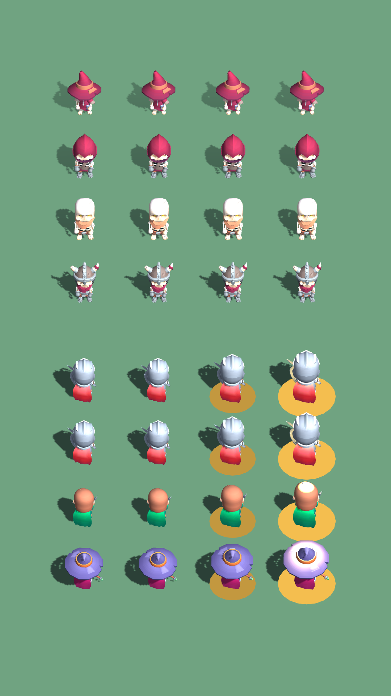
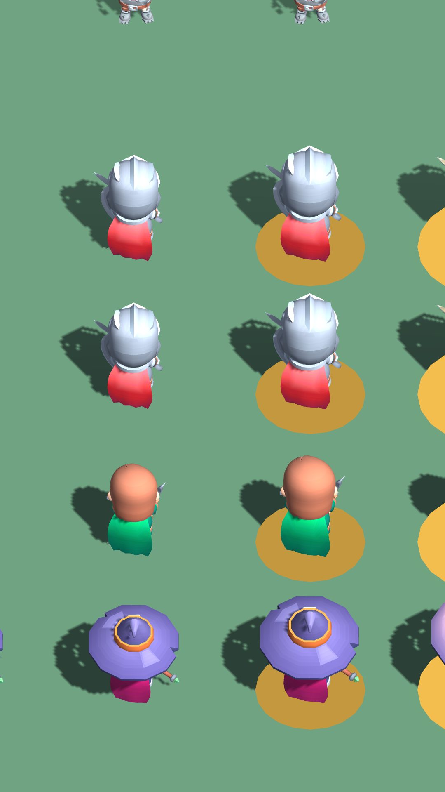

# Art direction (draft, PB-10)

Status: **draft, not decided.** This page collects the constraints, the options
and the first spike so Alican and Emir can decide. When they do, the decision goes
into DECISIONS.md, the chosen packs into CREDITS.md, and this page becomes the
style guide.

## 1. Constraints

| | |
|---|---|
| Budget | **To be set by the team.** Option A costs nothing; B costs about one pack price per seat; C needs quotes. |
| Platform | Android phones, portrait 9:16, IL2CPP ARM64, URP (D-001, PB-17). |
| Units on screen | Up to 16 per side plus effects (4×4 formation, D-031), so ≤ 32 characters. |
| Triangle budget | Card target 1.5–3k per unit. 32 × 3k ≈ 100k triangles for the units. Measured models below are 4.6–5.9k; that is ~170k for 32 units: probably fine on mid-range phones, to be checked in PB-15. |
| Style | Stylised low poly, one gradient/atlas texture per pack, no realistic textures. Readable from a top-down 45° camera at phone size: big heads and hats, clear silhouettes. |
| Animation | Idle, walk, attack, hit, death per unit (PB-12). Rigs that accept shared or Mixamo animations. |
| Class colours | Warrior red `#E85B55`, Archer green `#58C889`, Mage purple `#A77BE8`, Kingdom gold `#F4BE4F` (GDD, `Palette.cs`). Models must carry these colours or be tintable. |
| Tiers | T1 base, T2 larger + trim colour, T3 larger + glow (GDD §6). |
| Licence | Commercial use, no attribution that we could forget, may be modified. Listed in CREDITS.md **before** committing. |

## 2. Options

| | A. Free CC0 packs | B. Paid store packs | C. Freelancer |
|---|---|---|---|
| Examples | **KayKit** Adventurers (Knight, Mage, Rogue, Barbarian; newer itch.io version adds Ranger) and Skeletons; **Quaternius** (Animated Knight, RPG Character Pack, Ultimate Monsters, Universal Animation Library) | **Synty POLYGON** Fantasy Characters ($29.99 list price on the Asset Store and Synty store; Synty also sells a subscription), other low-poly fantasy packs | 3 classes × 3 tiers + 4 goblins, made for us |
| Licence | CC0: free for commercial use, no attribution required | Standard Unity Asset Store EULA (per seat; check each pack page before buying) | Contract: we must get full rights in writing |
| Cost | 0 (optional tips) | Per pack, per seat | Quotes needed from 2–3 artists (ArtStation, Fiverr/Upwork); not collected yet |
| Matches our classes | KayKit: Knight = Warrior, Rogue with crossbow = Archer (or the itch.io Ranger), Mage = Mage. Capes are already red / green / purple. | Large casts, likely fits | Exactly |
| Goblins | **None found as CC0 in the same style.** KayKit Skeletons fit the style; Quaternius' animated goblin is Patreon-only. | Synty sells fantasy enemy packs (check which have goblins) | Exactly |
| Animations | KayKit models ship with basic animations; KayKit and Quaternius have free CC0 animation packs | Usually included or via Mixamo | Extra cost |
| Integrate | Hours (spike below) | Hours, after buying | Weeks: style frame, revisions |
| Main risk | No goblins: change the enemy to skeletons, or mix styles | Synty look is very common; cost per seat | Time and money; single point of failure |

## 3. Spike: KayKit (option A), 2026-11-17

Tool: `Scripts/Editor/ArtSpike.cs` (*Puzzle Kingdoms → Art Spike Screenshots*).
It loads the models from `Assets/_Project/Sandbox/KayKit/` (git-ignored, so no
third-party file is committed before the decision), lays out a full 4×4 army
against a 4×4 skeleton army, poses them with their idle clip, scales tier 2 and 3
(110 %, 120 %, gold ring, glow) and renders 1080×1920 shots to `Logs/ArtSpike/`.

| Front camera (pitch 45°, yaw 0°) | 45° iso camera (pitch 35°, yaw 45°) | Close-up |
|---|---|---|
|  |  |  |

Findings:
- **The look works at phone size:** big helmets and hats read well from above,
  and the class colours are already red / green / purple.
- **Camera for PB-11:** the yaw-0 camera fits both armies in portrait; the 45° yaw
  pushes them off screen. Start PB-11 with pitch ~45°, yaw 0°.
- **Models need cleanup:** every weapon and shield variant is switched on in the
  FBX; the spike hides all but one set per class. Models are ~2.6 m tall and must
  be scaled to the cell (1.15 m at tier 1 in the spike).
- **Triangles (visible parts):** Knight 5.3k, Rogue 5.1k, Mage 4.9k, skeletons
  4.6–5.9k. Above the 3k target; measure on a phone in PB-15 before worrying.
- **Tier look:** size alone is hard to read at 110 %; the gold ring under T2/T3
  reads well. Keep the ring, maybe a coloured trim later.
- Not yet tried on a phone (needs PB-1) and option B not tried (needs a purchase).

## 4. Draft style guide (if option A is chosen)

- **Palette:** class colours as above on capes, hats and UI; enemies in bone white
  and dark red; ground muted green `#4A6B4F`; UI navy `#1E2230` with gold accents.
- **No outlines** on 3D models (the low-poly shading is enough); UI keeps flat
  panels.
- **Tiers:** T1 plain; T2 110 % + gold ring under the feet; T3 120 % + brighter
  ring + soft glow.
- **UI:** keep the current flat grey-box style until a UI pack is chosen (Kenney
  UI Pack, CC0, is the candidate).

## 5. Open questions for the team

1. What is the art budget?
2. Goblins or skeletons? Option A almost forces skeletons (or a mixed style);
   that changes the GDD enemy names and the tutorial texts.
3. Who leads the decision, and by when (M4 needs models)?
