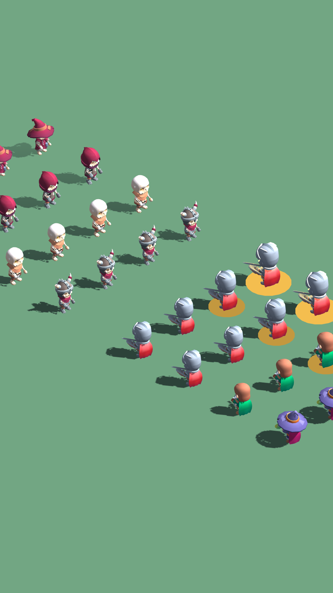
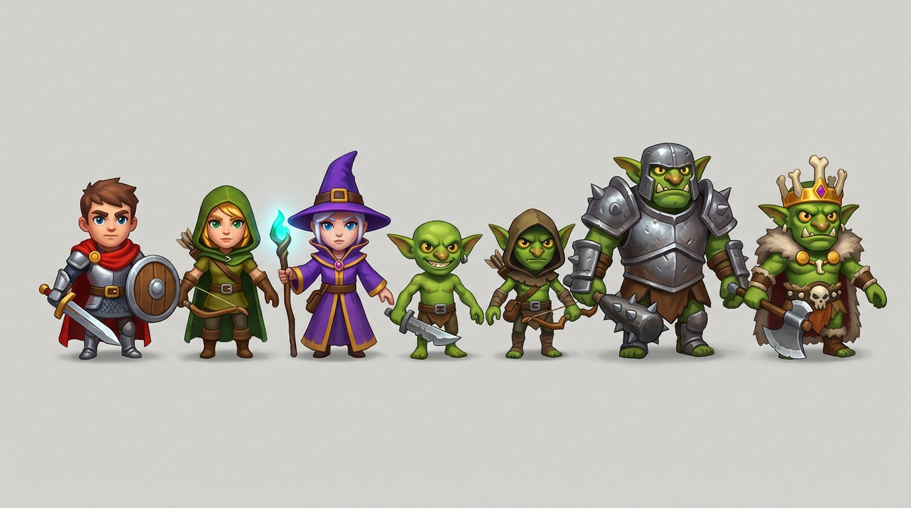
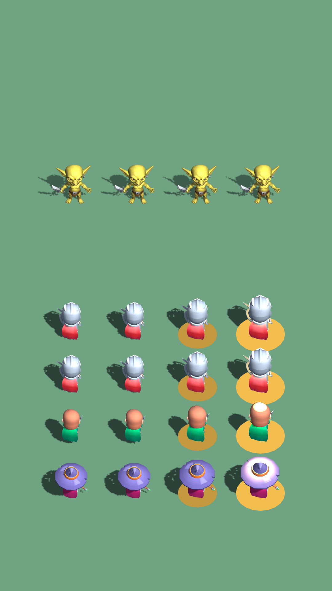
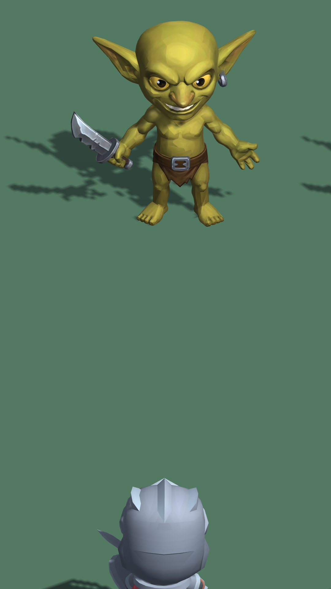
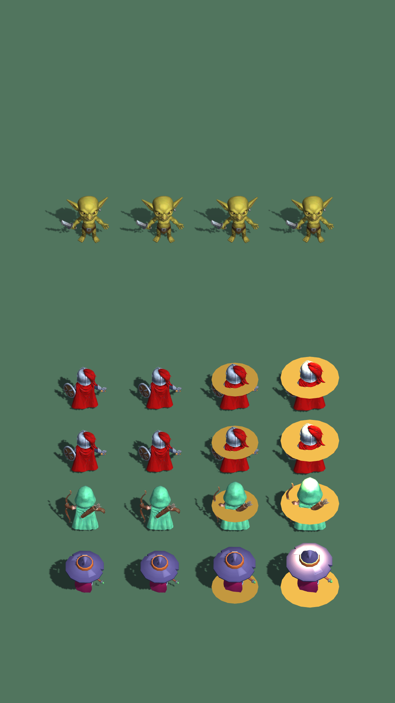

# Art direction (PB-10)

Status: **direction chosen (D-041): KayKit units + AI-made goblins; goblins still to be made.** This page collects the constraints, the options
and the first spike so Alican and Emir can decide. When they do, the decision goes
into DECISIONS.md, the chosen packs into CREDITS.md, and this page becomes the
style guide.

## 1. Constraints

| | |
|---|---|
| Budget | **To be set by the team.** Option A costs nothing; B costs about one pack price per seat; C needs quotes. |
| Platform | Android phones, portrait 9:16, IL2CPP ARM64, URP (D-001, PB-17). |
| Units on screen | Up to 16 per side plus effects (4×4 formation, D-031), so ≤ 32 characters. |
| Triangle budget | Card target 1.5–3k per unit. 32 × 3k ≈ 100k triangles for the units. Measured models below are 4.6–5.9k; that is ~170k for 32 units: probably fine on mid-range phones, to be checked in PB-15. |
| Style | Stylised low poly, one gradient/atlas texture per pack, no realistic textures. Readable from a top-down 45° camera at phone size: big heads and hats, clear silhouettes. |
| Animation | Idle, walk, attack, hit, death per unit (PB-12). Rigs that accept shared or Mixamo animations. |
| Class colours | Warrior red `#E85B55`, Archer green `#58C889`, Mage purple `#A77BE8`, Kingdom gold `#F4BE4F` (GDD, `Palette.cs`). Models must carry these colours or be tintable. |
| Tiers | T1 base, T2 larger + trim colour, T3 larger + glow (GDD §6). |
| Licence | Commercial use, no attribution that we could forget, may be modified. Listed in CREDITS.md **before** committing. |

## 2. Options

| | A. Free CC0 packs | B. Paid store packs | C. Freelancer |
|---|---|---|---|
| Examples | **KayKit** Adventurers (Knight, Mage, Rogue, Barbarian; newer itch.io version adds Ranger) and Skeletons; **Quaternius** (Animated Knight, RPG Character Pack, Ultimate Monsters, Universal Animation Library) | **Synty POLYGON** Fantasy Characters ($29.99 list price on the Asset Store and Synty store; Synty also sells a subscription), other low-poly fantasy packs | 3 classes × 3 tiers + 4 goblins, made for us |
| Licence | CC0: free for commercial use, no attribution required | Standard Unity Asset Store EULA (per seat; check each pack page before buying) | Contract: we must get full rights in writing |
| Cost | 0 (optional tips) | Per pack, per seat | Quotes needed from 2–3 artists (ArtStation, Fiverr/Upwork); not collected yet |
| Matches our classes | KayKit: Knight = Warrior, Rogue with crossbow = Archer (or the itch.io Ranger), Mage = Mage. Capes are already red / green / purple. | Large casts, likely fits | Exactly |
| Goblins | **None found as CC0 in the same style.** KayKit Skeletons fit the style; Quaternius' animated goblin is Patreon-only. | Synty sells fantasy enemy packs (check which have goblins) | Exactly |
| Animations | KayKit models ship with basic animations; KayKit and Quaternius have free CC0 animation packs | Usually included or via Mixamo | Extra cost |
| Integrate | Hours (spike below) | Hours, after buying | Weeks: style frame, revisions |
| Main risk | No goblins: change the enemy to skeletons, or mix styles | Synty look is very common; cost per seat | Time and money; single point of failure |

## 3. Spike: KayKit (option A), 2026-11-17

Tool: `Scripts/Editor/ArtSpike.cs` (*Puzzle Kingdoms → Art Spike Screenshots*).
It loads the models from `Assets/_Project/Sandbox/KayKit/` (git-ignored, so no
third-party file is committed before the decision), lays out a full 4×4 army
against a 4×4 skeleton army, poses them with their idle clip, scales tier 2 and 3
(110 %, 120 %, gold ring, glow) and renders 1080×1920 shots to `Logs/ArtSpike/`.

| Front camera (pitch 45°, yaw 0°) | 45° iso camera (pitch 35°, yaw 45°) | Close-up |
|---|---|---|
|  |  |  |

Findings:
- **The look works at phone size:** big helmets and hats read well from above,
  and the class colours are already red / green / purple.
- **Camera for PB-11:** the yaw-0 camera fits both armies in portrait; the 45° yaw
  pushes them off screen. Start PB-11 with pitch ~45°, yaw 0°.
- **Models need cleanup:** every weapon and shield variant is switched on in the
  FBX; the spike hides all but one set per class. Models are ~2.6 m tall and must
  be scaled to the cell (1.15 m at tier 1 in the spike).
- **Triangles (visible parts):** Knight 5.3k, Rogue 5.1k, Mage 4.9k, skeletons
  4.6–5.9k. Above the 3k target; measure on a phone in PB-15 before worrying.
- **Tier look:** size alone is hard to read at 110 %; the gold ring under T2/T3
  reads well. Keep the ring, maybe a coloured trim later.
- Not yet tried on a phone (needs PB-1) and option B not tried (needs a purchase).

## 4. Draft style guide (if option A is chosen)

- **Palette:** class colours as above on capes, hats and UI; enemies in bone white
  and dark red; ground muted green `#4A6B4F`; UI navy `#1E2230` with gold accents.
- **No outlines** on 3D models (the low-poly shading is enough); UI keeps flat
  panels.
- **Tiers:** T1 plain; T2 110 % + gold ring under the feet; T3 120 % + brighter
  ring + soft glow.
- **UI:** keep the current flat grey-box style until a UI pack is chosen (Kenney
  UI Pack, CC0, is the candidate).

## 5. Open questions for the team

1. What is the art budget?
2. Goblins or skeletons? Option A almost forces skeletons (or a mixed style);
   that changes the GDD enemy names and the tutorial texts.
3. Who leads the decision, and by when (M4 needs models)?

## 6. Option D: we make the goblins with AI (chosen to try, D-041)

Budget is zero, so: **player units from KayKit (CC0), the four goblins made
with Meshy's free plan.** Other free AI routes do not fit: Tripo's free plan is
non-commercial; TRELLIS needs 16 GB+ of GPU memory (our laptop has 8 GB);
Hunyuan3D's licence excludes the EU, UK and South Korea.

**Licence of Meshy free models: CC BY 4.0.** Commercial use is allowed, but the
game must credit Meshy (a Credits screen; PB-16/PB-17), and the models are not
exclusively ours. Each goblin we keep goes into CREDITS.md before it is
committed. If we later pay for one month, models made then are fully ours.

Free plan: ~100 credits a month, enough for about 3–5 models; plan the tries.

### Steps (the person with the Meshy account)

1. Sign up at meshy.ai (free plan). Use **Text to 3D**.
2. Settings, when offered: art style **low poly / stylised**, **symmetry on**,
   pose **T-pose or A-pose** (needed for rigging), target polycount as low as
   allowed (we aim for ~3,000 triangles).
3. Prompt: the common style line plus one goblin line (below). Generate, pick
   the best preview, refine/texture it.
4. Download **FBX** (Unity reads FBX; GLB needs an extra package). Rename and put
   it in `Assets/_Project/Sandbox/Goblins/` (git-ignored) as
   `Goblin_Grunt.fbx`, `Goblin_Archer.fbx`, `Goblin_Brute.fbx`, `Goblin_Chief.fbx`
   (textures next to them).
5. Run *Puzzle Kingdoms → Art Spike Screenshots* (Unity closed: batch command in
   the class comment). `Logs/ArtSpike/Goblins-*.png` shows them against the
   KayKit army, and `report.txt` lists their triangles.
6. Keep or retry. Rigging and animations come later (Meshy rigging or Mixamo, PB-12).

### Prompts

Style line (use for every goblin, so the four match KayKit):

> Stylised low poly game character, chibi proportions with a big head and short
> body, simple flat colours with soft gradient shading, clean readable silhouette,
> no small details, T-pose, full body, front facing, game asset for a mobile
> strategy game, in the style of KayKit characters.

| File | Goblin line | Why (GDD §8) |
|---|---|---|
| `Goblin_Grunt` | A small green goblin foot soldier with pointy ears, ragged brown leather tunic and a crude short sword. | baseline melee |
| `Goblin_Archer` | A thin green goblin archer with a hood, a short wooden bow and a quiver on the back. | ranged, back row |
| `Goblin_Brute` | A big, bulky green goblin brute in heavy dented iron armour plates with a helmet and a large club. | armoured (50 %): must look armoured |
| `Goblin_Chief` | A large goblin chieftain with a bone crown, a red fur cape, gold trim and a big axe. | boss: larger, stands out |

Colours: goblin skin is green, like our Archers' capes. Keep goblin clothes and
armour brown, grey, iron and bone, and avoid red and purple on them, so the two
armies never mix up at a glance. Check the Archer row against the goblins in the
spike render.

### Result of the first try (2026-11-17, Meshy free plan, via the Chrome extension)

- Meshy has no one-step Text to 3D any more: text → image (Nano Banana, 3 credits
  per image), then image → 3D. "Smart Topology" T2.5 with texture costs 15 credits
  and lets us set 3,000 polygons. One goblin ≈ 24 credits. Free plan: 100 credits
  a month plus daily-login bonuses.
- **Goblin_Grunt made: 3,154 triangles, textured, arms down (not a T-pose,** the
  prompt alone does not get one; the Pose tool is paid).
- **The free plan cannot download models** (any format asks for a subscription).
  The daily-login rewards include one download on day 5.
- Paid plans: Starter / Pro (prices shown billed yearly; the monthly-billed price is
  still to be checked). Paid-plan models are fully ours, no CC BY attribution.

So the zero-budget route needs either the one free download (enough to judge the
Grunt in the game) or one paid month. Until then: KayKit Skeletons stand in for the
goblins (CC0), and no more credits are spent on goblins we cannot download.

### Style frame (Meshy Pro, 2026-11-17)

Alican bought Meshy Pro, so downloads work and models made on it are ours (private
licence, no attribution). First a style frame with the whole cast, picked from 4
(Nano Banana Pro, 36 credits): **#1**, for its size steps (grunt → brute → chief),
the knight's red plume (reads as "Warrior red" from above) and arms and weapons
away from the body. Real game names are kept out of all prompts.

Fixes for the per-character images: goblin skin olive / yellow-green and the hero
archer's cloak bright mint `#58C889`, so they do not share one green; no red on the
goblin chief (gold gems, brown loincloth).

### Correction and cast plan (2026-11-17)

The chosen style frame "#1" is the one with the bare-headed knight, the white-haired
mage and the bone crown (the image above, full resolution). The red-plume knight
mentioned before belonged to another frame; the plume is added in the knight's own
prompt instead.

Method that works (Goblin_Grunt try 2): crop the character out of the style frame,
use **only that crop** as the reference image, describe the style in our own words
(no real game names), A-pose option on, 2 images, pick, then image → 3D (textured,
multi-view, remesh ~5,000 polygons), FBX.

Cast: 7 models. Heroes: Knight (red plume helmet, red cape), Archer (mint `#58C889`
hooded cloak), Mage (purple). Goblins: Grunt (done), Archer, Brute (6,000 polygons),
Chief (8,000, no red). **Tiers are not separate models:** T2 = same model at 110 %
with a Meshy retexture (silver and gold trim), T3 = 120 % with a gold / royal
retexture plus a glow effect in Unity. One mesh per class keeps the rig and the
animations shared and the upgrade obvious after a merge.

### Goblin_Grunt in the game camera (2026-11-17)

Meshy 7.1 high detail + texture, remeshed to **5,222 triangles**, private licence
(70 credits with one failed try: the Pose tool dropped the sword, so convert an
A-pose image with Pose = none). Meshy FBX files arrive Z-up, facing backwards and in
centimetres (root scale ×100); `ArtSpike` now stands such models up, turns them
round, multiplies instead of replacing the scale and puts every model on the ground.

Reads well at phone size and the yellow-olive skin is clearly not the archers'
green. Next to the flat KayKit heroes the painted goblin looks like another game,
which is why the heroes are being made in Meshy from the same style frame.

Update: the first Grunt render was too bright (lemon yellow, not the matte olive of the
Meshy preview). The spike lighting is now softer (sun 0.85, ambient 0.42) and the colour
matches. Close-up from the battle camera:

### Approved models are in git (2026-11-18)

Own-made Meshy Pro models live in `Assets/_Project/Art/Characters/<Name>/` (FBX and
base-colour texture; ~14 MB each), so Emir has them and they are backed up. New downloads are
tried first in the git-ignored `Assets/_Project/Sandbox/Meshy/`. In: **Goblin_Grunt** (5,222
triangles), **Hero_Knight** (5,197) and **Hero_Archer** (5,208). KayKit stays only as a stand-in for
the Mage, outside git.

Meshy does not export every model with the same axes: the Grunt stands up with +90° about X, the
Knight with −90°. `ArtSpike.FacingCamera` keeps the rotation per model; find a new one by
rendering four candidates side by side. The Knight seen from above reads as the red Warrior.

Heads-up on size: every re-export adds ~14 MB to the history. Keep only approved models here and
consider Git LFS once the cast is complete (7 models, ~100 MB).

## 7. Prompts for the remaining characters (Meshy Pro)

Method for each: crop the character from the style frame (`<Name>_reference.png`, kept in the
Downloads folder of whoever runs Meshy), put **only that crop** in "Görsel Referanslar", generate
2 images (Nano Banana Pro, 3:4, Pose = None), choose one, then image → 3D (Meshy 7.1 high detail +
texture, Pose = none, private licence), remesh custom target 5,000 triangles (Brute 6,000, Chief
8,000) triangle topology keeping the texture, check front / side / back, download FBX with
textures. Prompts stay under 800 characters and never name a real game.

Common start of every prompt:

> Hand-painted cartoon style exactly like the reference image: same face style, big expressive
> eyes, large head, chunky simple shapes, painted textures with soft gradients. Full body, front
> view, A-pose, arms away from the body, weapon clearly separate from the body, plain light grey
> background.

| Name | Prompt after the common start |
|---|---|
| Hero_Archer | A cheerful young archer with a bright mint green hooded cloak and hood (#58C889) with white trim, a light brown tunic, brown leather gloves and boots, a quiver of arrows on the back, a wooden longbow held out to the side. No dark green. |
| Hero_Mage | A determined young mage with white hair, a tall purple pointed hat with a gold buckle, a long purple robe with gold trim and a high collar, a small brown satchel, a twisted wooden staff with a glowing cyan flame held out to the side. |
| Goblin_Archer | A lean sneaky goblin archer with olive yellow-green skin, a brown hooded cloak with a torn collar, one bandaged arm, a small leather pouch on the belt, a quiver of feathered arrows on the back, a short curved wooden bow held out to the side. No red, no purple. |
| Goblin_Brute | A huge hulking goblin brute, much wider than the others, olive yellow-green skin, a steel helmet, heavy dented iron armour plates with spiked shoulder pads and iron bracers, a ragged brown loincloth, a giant spiked iron club held out to the side. Must clearly look armoured. No red, no purple. |
| Goblin_Chief | A large proud goblin chieftain, the boss, olive yellow-green skin, a crown of bones and gold with GOLD gems (no red or purple gems), a fur-collared dark brown cape, round gold shoulder discs, a bone necklace, a belt with a skull buckle, a brown loincloth (no red), a big double-headed steel axe held out to the side. |

Done so far: Goblin_Grunt, Hero_Knight, Hero_Archer (in `Assets/_Project/Art/Characters/`). Colours: heroes
red / mint / purple, goblins olive with brown, iron and bone, so no army mixes up with the other.
Credits used so far: about 330 of the Pro plan's ~1,400.
