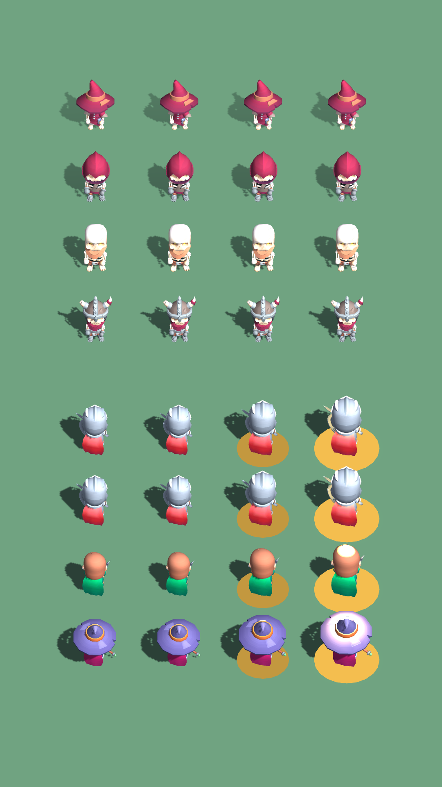

# PB-10 Art direction decision

Owner: Alican (prepares), both decide · Milestone: M3 (runs in parallel) · Size: M ·
Branch: `feature/PB-10-art-direction` · Replaces: M3-05

## Why
M4 (3D battle) needs models, and the whole game needs one consistent look.
Buying the wrong pack, or hiring too late, blocks M4 for weeks. The choice
(asset packs vs. a freelancer vs. a mix) has to be made with real samples
in the game, not by browsing stores.

## Today
- All visuals are code-drawn placeholders (gem shapes D-027, unit silhouettes D-029).
- GDD colours: Warrior red `#E85B55`, Archer green `#58C889`, Mage purple
  `#A77BE8`, Kingdom gold `#F4BE4F`; UI navy `#1E2230`
  ([Palette.cs](../../Assets/_Project/Scripts/Views/Common/Palette.cs)).
- No art budget written down.

## Build
1. **Constraints first** (half a page): budget, mobile triangle budget
   (~1.5-3k triangles per unit, ≤ 40 units on screen), style (low-poly
   stylised fits mobile and packs), must work with Mixamo rigs, commercial license.
2. **Shortlist 3 directions**, each with: where it comes from, price, license,
   what is missing (enemies? tiers?), time to integrate:
   - A. Free CC0 low-poly: **Quaternius** (quaternius.com, CC0, characters and
     fantasy props), **Kenney** 3D kits (CC0, e.g. *Castle Kit*, *Nature Kit*).
   - B. Paid store packs: low-poly fantasy character packs on the Unity Asset
     Store (e.g. Synty-style *POLYGON* fantasy sets); check the Standard
     Unity Asset Store EULA allows the use.
   - C. Freelancer: 3 units + 4 goblins + tiers, quotes from 2-3 artists
     (ArtStation, Fiverr/Upwork), with a style frame first.
3. **Spike:** put one Warrior and one Goblin from A (and B if affordable) into a
   test scene with the PB-11 camera, on a phone. Screenshot each.
4. Compare in a table (look, cost, gaps, risk) and pick.
5. Record the decision in DECISIONS.md; list chosen packs in CREDITS.md.
6. Write a one-page style guide in `docs/ART.md`: palette, outline/no outline,
   how tiers look (T2 trim colour, T3 glow per GDD §6), UI style.

## Look
Make a mood board (8-12 reference images, screenshots of games and packs) in
the card Notes or `docs/cards/img/pb-10-*`. Only link or reference images you do
not own; do not commit them into the game.

## Files
`docs/ART.md` (new), `docs/DECISIONS.md`, `CREDITS.md`; spike scene under
`Assets/_Project/Scenes/Sandbox/` (not used by the game; delete after or keep
excluded from builds).

## In Unity
- Import a `.fbx`: drag it into the Project window. In the Inspector, *Rig* tab →
  *Animation Type: Humanoid* if it will use Mixamo animations.
- Asset Store packs: *Window → Package Manager → My Assets*.

## Not in this card
Making all the art. Animations (PB-12).

## Done when
- [x] Constraints and 3 options with prices/licenses written down (freelancer quotes still missing)
- [ ] Spike screenshots on a phone for at least two options
- [x] Decision in DECISIONS.md, `docs/ART.md` style guide exists (D-041; goblins still to be made)

## Notes
2026-11-17 (Alican, with Claude):
- Draft in [docs/ART.md](../ART.md): constraints, options A/B/C, spike, draft style
  guide, open questions (budget, goblins vs skeletons, who decides).
- Spike A (KayKit Adventurers + Skeletons, CC0, from the official GitHub repos):
  `Scripts/Editor/ArtSpike.cs` renders a 4×4 vs 4×4 army in the editor; models stay
  in the git-ignored `Assets/_Project/Sandbox/`. Findings: readable at phone size,
  capes already in our class colours, 4.6–5.9k triangles per unit, no goblins
  (skeletons instead), yaw-0 camera fits portrait (for PB-11).

  
- Not done: phone screenshots (needs PB-1), option B spike (needs a purchase),
  freelancer quotes, the decision itself.
- **Decision D-041 (Alican):** budget zero. KayKit for our units; the four goblins
  made with Meshy's free plan (CC BY 4.0: credit Meshy in the game). Steps and
  prompts in [docs/ART.md](../ART.md) §6. `ArtSpike` now also renders KayKit vs
  `Sandbox/Goblins/*.fbx` as soon as the files are there. Fallback: skeletons.
