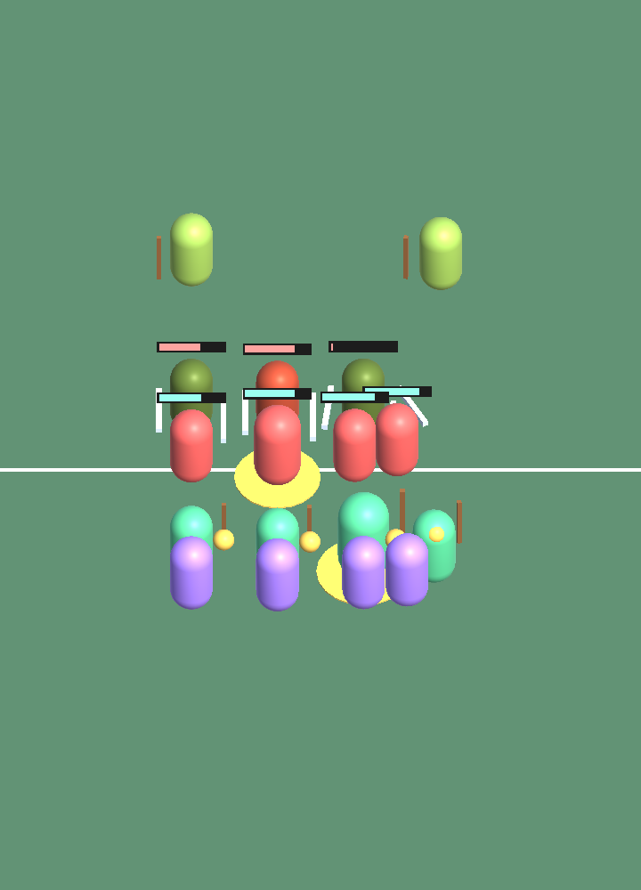
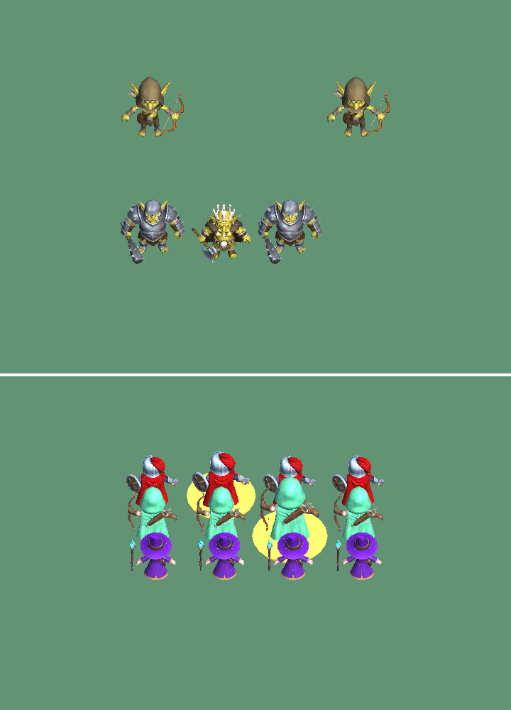

# PB-11 3D battle scene

Owner: — (suggested Emir) · Milestone: M4 · Size: L · Branch: `feature/PB-11-battle-3d` ·
Replaces: M4-01, M4-02, M4-05 · Needs: PB-10 (or placeholder capsules first)

## Why
The battle is the payoff of every puzzle and War Camp decision. The 2D debug
view proves the rules work but does not sell the fantasy of *your* army
marching into goblins. The GDD calls for an isometric 3D view on top of the
same simulator; this card builds that view without changing any rule.

## Today
- [BattleSimulator.cs](../../Assets/_Project/Scripts/Logic/Combat/BattleSimulator.cs):
  deterministic, 20 ticks/s; units are `Combatant`s with a position (cells),
  HP, target; it emits `BattleEvent`s (attacks, hits, deaths, Rally).
- [BattleScreen.cs](../../Assets/_Project/Scripts/Views/Battle/BattleScreen.cs):
  2D uGUI view; maps positions to the screen, HP bars, floating damage numbers,
  Rally / 1x-2x / Pause / Skip buttons. Use it as the reference for *what* to show.
- Geometry: front rows 6 cells apart, rows 1 cell, lanes 1.2 cells
  (`Data/BattleRules.asset`).

## Build
1. **Scene setup:** a battle root with a ground plane, an orthographic camera
   (rotation ~30° down, 45° around; tune), directional light. Either a separate
   scene loaded additively or a prefab the Flow instantiates; agree in the
   check-in (scenes are merge-hostile: one owner).
2. **Mapping:** simulator position (cells) → world (metres), 1 cell = 1 m;
   player army bottom-left, enemy top-right. Interpolate between ticks for
   smooth motion (keep previous and current tick positions, lerp by the
   fraction of the tick).
3. **Placeholder models:** start with coloured capsules + a cone/box for the
   weapon, coloured by class (Palette). Then swap in the models chosen in PB-10.
   Tier: scale 1.0 / 1.1 / 1.2; T2 trim colour, T3 glow (emissive material).
4. **Readability:** world-space HP bar above each unit (only after first
   damage), floating damage numbers (reuse logic from BattleScreen), a
   projectile for Archers (arrow) and Mages (orb) from attacker to target.
5. **HUD:** keep the existing uGUI buttons (Rally, 1x/2x, Pause, Skip) as an
   overlay canvas.
6. **Flow:** the 3D view replaces the 2D view; keep the 2D debug view behind a
   toggle (useful for bugs).

## Look

Prototype assets (CC0 unless noted; add to CREDITS.md first):
- Units and goblins: **Quaternius** low-poly character packs (quaternius.com, CC0);
  **Kenney** *Mini Characters* / *Blocky Characters* (kenney.nl, CC0).
- Ground and props: **Kenney** *Nature Kit*, *Castle Kit* (CC0).
- Until those arrive: Unity primitives (*GameObject → 3D Object → Capsule*).

## Files
New `Views/Battle3D/` (e.g. `BattleView3D.cs`, `UnitActor.cs`,
`ProjectileActor.cs`), a prefab or scene under `Assets/_Project/Prefabs/` or
`Scenes/`, `Flow/GameApp.cs` (choose view). STRUCTURE.md.
No changes in `Logic/`.

## In Unity
- Camera: select it, Inspector → *Projection: Orthographic*, then rotate it in
  the Scene view; *GameObject → Align With View* (Ctrl+Shift+F) copies the
  Scene view angle to the selected camera.
- URP materials: right-click → *Create → Material*, shader *Universal Render
  Pipeline/Lit*; for the T3 glow tick *Emission*.
- Prefab: drag a configured object from the Hierarchy into the Project window.

## Not in this card
Animations and VFX (PB-12), new rules, camera shake (PB-12).

## Done when
- [ ] Battle plays in 3D for all three stages; units move smoothly, attack, die
- [ ] Results identical to the 2D view (same winner and duration for the same input)
- [ ] HP bars, damage numbers, projectiles readable on a phone screen
- [ ] Rally / 1x-2x / Pause / Skip work; 2D view still reachable by a toggle
- [ ] Runs at 30+ fps on the PB-1 phone; screenshot in Notes

## Notes
2026-11-18 (Alican, with Claude) — first slice, capsule stand-ins:
- Built in code, no scene edit: `Views/Battle3D/BattleWorld3D` (ground, sun, orthographic camera at
  pitch 45° / yaw 0°, one `UnitActor` per combatant) draws into a `RenderTexture` on its own layer far
  from the origin; `BattleScreen` shows it in the field (`RawImage`) and keeps the HUD, the Rally
  button, the tutorial hook and `GameApp` exactly as they were. 3D is the default, the **2D** button
  in the top left of the field switches to the old grey-box view.
- Done in this slice: 1 cell = 1 m mapping, smooth motion (previous/current tick, lerp by the tick
  fraction), units turn to their target, hit flash, death squash, world-space HP bar after the first
  damage, floating damage numbers above the head, arrow / orb projectiles for ranged units, tier
  scale 1.0 / 1.1 / 1.2 with a gold ring, class colours from `Palette`.
- Check without opening the game: *Puzzle Kingdoms → Battle 3D Screenshots* (or batch
  `-executeMethod PuzzleKingdoms.EditorTools.BattleView3DSpike.Capture`) plays stage 1-3 against a full
  army and saves frames to `Logs/Battle3D/`. Tests: EditMode 192/192, PlayMode 14 passed, 0 failed.
- The rules are untouched (`Logic/` has no change), so 2D and 3D give the same winner and duration
  by construction; there is no automated test for that.

  
- Second slice, the PB-10 models (D-042): `Data/BattleModels.asset` (`BattleModelSet`) maps each
  `UnitLook` to a model, a URP Lit material with its texture and the rotation that stands a Meshy
  export up; `GameContent` links it and `GameApp` registers it (`UnitModels`). A look without an
  entry stays a capsule. The model is scaled to 1.15 m at tier 1 (Meshy exports are in centimetres),
  feet on the ground, 1.1 / 1.2 for tier 2 / 3, the hit flash brightens the texture. Rebuild the
  data with *Puzzle Kingdoms → Build Battle Models* (batch `-executeMethod
  PuzzleKingdoms.EditorTools.BattleModelBuilder.Build`) after changing a model.
  The static (unrigged) FBX from `Art/Characters/` are used; the rigged ones come with PB-12.

  
- T3 glow done: a bright ring and a soft gold emission on the body (checked in the frames).
- Still to do: phone check (PB-1) and fps on the phone, a screenshot of the real
  game screen, and a look at the first frame in the real game (the editor render needs a warm-up frame).
