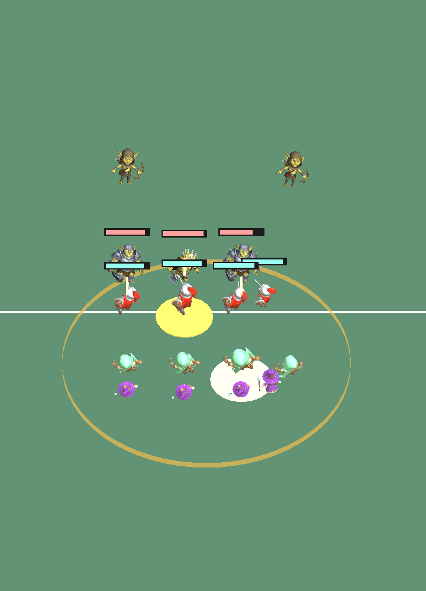

# PB-12 Battle life: animations and effects

Owner: — · Milestone: M4 · Size: L · Branch: `feature/PB-12-battle-life` ·
Replaces: M4-03, M4-04 · Needs: PB-11

## Why
Sliding capsules do not feel like a battle. Walk, swing, get hit and fall over
are what make players read "my Warriors are winning the front line". Rally is
the player's one big input in the battle; without a strong effect it feels like
nothing happened.

## Today
- PB-11 gives 3D actors driven by simulator positions and `BattleEvent`s
  (attack, hit, death, Rally start/end).
- Rally rule: +35% damage and attack speed for 5 s (GDD §9).

## Build
1. **Animator per class:** states Idle, Walk, Attack, Hit, Death; parameters
   `speed` (float), `attack` / `hit` / `die` (triggers).
   - `speed` from the actor's movement per frame;
   - `attack` on the attack event, timed so the hit frame lands on the event
     (start the clip `attack interval × 0.5` earlier or simply accept the offset);
   - Death: play, then sink into the ground and remove after 1.5 s.
2. **Animations (D-043):** from **Meshy**, not Mixamo. All seven characters are rigged
   (Humanoid, Mixamo skeleton template) and the clips live on one model and are shared by
   Humanoid retargeting. Needed: idle, walk/run, attack (a generic one, a sword one, an axe one
   for the Chief), hit reaction, death. Check that each looks right on every character; the
   Mage's staff bends (skinned to the body), consider re-skinning or hiding the bend.
3. **Rally:** golden ring expanding from the army centre, gold aura on every
   ally for 5 s, units' animation speed ×1.35 during Rally, a horn sound,
   camera shake 0.2 s.
4. **Hit feedback:** white flash on the hit unit (0.08 s), small knockback
   (visual only, 0.1 m), dust puff on melee hits; magic hit purple spark.
5. **Death:** goblin poof (dust), gold coin pop for killed enemies (visual only).
6. Battle sounds: swords, arrows, magic, death grunts (Kenney *RPG Audio*,
   *Impact Sounds*, CC0).

## Look
Same layout as PB-11's mockup; this card adds motion. Reference: any auto-battler
(Auto Chess, TFT) at 0.25× speed; note how short attack anticipation is.

Prototype assets (add to CREDITS.md first): **Kenney
Particle Pack** (CC0) for dust, sparks, aura; Kenney audio packs (CC0).

## Files
`Views/Battle3D/*`, Animator Controllers and clips under
`Assets/_Project/Art/Animations/`; rigged Meshy FBX files first in the git-ignored
`Assets/_Project/Sandbox/Meshy/<Name>_Rig/` (D-043).

## In Unity
- Meshy rigged FBX: nothing to click. Name the file `<Name>_Rig.fbx`, `<Name>_RigAnim.fbx` or
  `Clips_<Name>.fbx` under `Assets/_Project/Art/` (or the Sandbox) and `MeshyRigImport` sets
  *Humanoid*, drops the finger mapping (it breaks Meshy's extra "SmartRig" bones, see D-043) and
  loops Running / Walking / Idle. It runs after an import by itself; to run it again by hand:
  *Puzzle Kingdoms → Fix Meshy Rigs*, or in batch mode
  `-executeMethod PuzzleKingdoms.EditorTools.MeshyRigImport.FixAll` (report in
  `Logs/meshy-rig-import.txt`). On a first import the Console shows one "Rig Error" for the
  Grunt; that is the first pass, the tool fixes it right after.
- Use `Hero_Archer_RigAnim`, not a rig-only download of the Archer: that one stays broken.
- Animator: right-click → *Create → Animator Controller*, double-click to open
  the Animator window, drag clips in as states, add transitions (right-click a
  state → *Make Transition*), add parameters on the left.
- Particles: *GameObject → Effects → Particle System*; save as a prefab.

## Not in this card
New rules, new units, final art.

## Done when
- [ ] Every class has idle, walk, attack, hit, death in battle
- [ ] Rally is unmistakable (ring, aura, sound, shake)
- [ ] Hit flash and death effects; battle sounds
- [ ] 30+ fps on the PB-1 phone with 16 vs 8 units; recording in Notes
- [ ] All assets in CREDITS.md

## Notes
_Findings, screenshots, numbers, decisions taken while working on this card._

2026-11-18 (Alican, with Claude) — slices done:
- **Animation:** the seven rigged models (`<Name>_Rig.fbx`, Git LFS) and `Clips_Knight.fbx` are in
  `Art/`; `MeshyRigImport` makes them Humanoid. `BattleAnimatorBuilder` builds the one shared
  `BattleUnit.controller` (Idle, Walk, Attack, Hit, Death; parameters `speed`, `attackSpeed`,
  `attack`, `hit`, `die`), linked in `BattleModels.asset`. `UnitActor` drives it from the simulator:
  walk from the movement per tick, the Attack clip squeezed into the attack interval (faster in
  Rally), a hit stagger at most every 1.6 s, the Dead clip, 1.5 s lying, then sinking away.
  The Mage's staff bends.
- **Rally:** a thin gold ring spreads from the army centre (0.9 s), allies glow gold while it lasts,
  the camera shakes for 0.2 s.

  
- **Sounds:** five new generated clips in `SoundBank` (sword hit, bow shot, magic cast, unit died, Rally start) played by `BattleWorld3D`, at most 3 per frame so 32 units are not noise. They are placeholders like the rest (D-036).
- **Effects:** dust on melee hits, purple sparks on magic hits, a goblin poof (ring of puffs) and a visual-only coin pop when an enemy dies, grey puffs for a fallen hero; all small transient objects (no particle assets), capped at 70.
- **Clips (round 2):** the Meshy library does have them under Turkish names: "Boşta" = Idle (Boşta 1-11 more), "Okçuluk Atışı" = Archery_Shot, "Şarjlı Büyü Yap 1" = Charged_Spell_Cast_1. `Clips_Knight.fbx` now holds 8 clips; the controller has Attack (sword), AttackBow, AttackMagic chosen by `attackKind`, and a real Idle. The old English searches ("idle", "attack") found nothing useful. `MeshyRigImport` now follows the clips in the file instead of a list frozen in the .meta.
- **Not done yet:** (sounds were: needs new clips in
  `PlaceholderSounds` and `SoundBank`), dust on hits and the goblin poof, the coin pop, a real idle
  clip, bow / staff specific attack clips, the 30+ fps check on a phone (PB-1), CREDITS.md has
  no new third-party asset (Meshy clips are ours).
