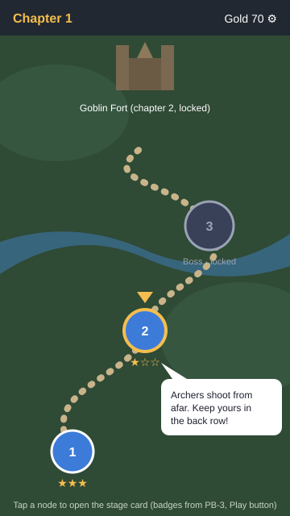

# PB-13 Stage map and tutorial

Owner: — · Milestone: M5 · Size: M · Branch: `feature/PB-13-map-tutorial` ·
Replaces: M5-01, M5-04

## Why
The stage list is a debug menu. A map with a path gives progress a shape
("I am getting closer to the fort") and makes the next stage obvious. The
tutorial matters more: testers should not need us to explain the loop. Each of
the three stages already teaches one lesson (GDD §11); short prompts at the
right moment make sure the lesson lands.

## Today
- [StageSelectScreen.cs](../../Assets/_Project/Scripts/Views/Menus/StageSelectScreen.cs):
  vertical list of buttons with stars, locked state, gold.
- Lessons per stage (GDD §11): 1-1 match, recruit, place; 1-2 protect the back
  line, merge; 1-3 Mages vs armour, Rally timing.
- `PlayerProfile` stores stars and unlocks.

## Build
1. **Map screen:** background image (one tall picture), a path, a node per stage
   (stars under it; locked nodes greyed; the current node has a bouncing arrow).
   Tap a node → a stage card (name, PB-3 badges, enemy preview, Play button).
   Node positions as data (normalised x/y on `StageDefinition`, or a small
   `ChapterMap` asset), not hardcoded.
2. **Tutorial system:** a `TutorialStep` list per stage as data
   (`Data/Tutorial/Stage_1_1.asset`): trigger (screen opened, first match, first
   unit recruited, War Camp opened, battle started, first loss), text, optional
   highlight target (a named UI element). Shown as a speech bubble with a dim
   overlay and a hole around the target; tap to continue.
   Seen steps stored in `PlayerProfile` (needs a logic change + test + save
   version bump; DECISIONS.md entry).
3. **Prompts** (starting text, short):
   - 1-1 puzzle start: "Match 3 gems of a colour. Red gems recruit Warriors."
   - 1-1 first unit: "A Warrior joined! Watch the enemy above: 6 Grunts."
   - 1-1 War Camp: "Drag units onto the grid. The top row faces the enemy."
   - 1-2 puzzle: "Grey half gems are stone: the first match only breaks it."
   - 1-2 War Camp: "Archers shoot from afar. Keep yours in the back row."
     and "3 of the same → Merge for a stronger unit."
   - 1-3 puzzle: "Brutes are armoured. Mages (purple) ignore armour."
   - 1-3 battle: "Tap Rally when the armies meet!"
4. Skip button ("Skip tutorial"), and a reset in Settings (PB-14).

## Look

Prototype assets: map background from **Kenney** *Map Pack* / *Medieval RTS*
(kenney.nl, CC0) tiles, or a free painted map from **OpenGameArt.org** (check
license). Bubble and frames from **Kenney UI Pack** (CC0). Add to CREDITS.md first.

## Files
New `Views/Menus/StageMapScreen.cs`, `Views/Common/TutorialOverlay.cs`,
`Data/TutorialSteps.cs` (ScriptableObject) + assets; `Logic/Progression/PlayerProfile.cs`
(seen steps) + tests; `Flow/GameApp.cs`. DECISIONS.md, STRUCTURE.md.

## In Unity
- Background image: drag the PNG into the Project window, Inspector *Texture
  Type: Sprite (2D and UI)*, Apply.
- Tutorial assets: right-click → *Create → Puzzle Kingdoms → Tutorial Steps*
  (after adding `CreateAssetMenu`), fill the list in the Inspector.

## Not in this card
Chapter 2, new stages, voice-over.

## Done when
- [ ] Map replaces the list; nodes, stars, locks, current-stage arrow, stage card
- [ ] Tutorial prompts appear once per player at the right moments; skippable
- [ ] Seen steps saved; tests green; DECISIONS.md updated
- [ ] A new person plays 1-1 with no help from us (note who and how it went)

## Notes
_Findings, screenshots, numbers, decisions taken while working on this card._
