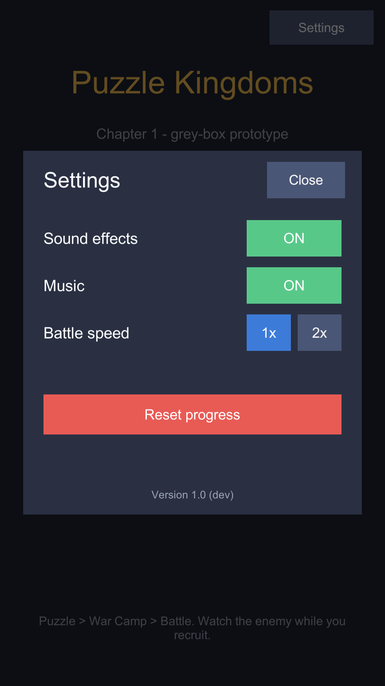

# PB-14 Settings and save safety

Owner: Alican · Milestone: M5 · Size: M · Branch: `feature/PB-14-settings-save` ·
Replaces: M5-03, M5-05

## Why
Two different jobs, both small and both needed before players keep the game:
- **Save safety:** losing progress is the fastest way to lose a player.
  `ProfileStore` already tries to be safe, but nothing proves it.
- **Settings:** players expect to mute sound, choose battle speed and reset
  progress (also useful for us and testers).

## Today
- [ProfileStore.cs](../../Assets/_Project/Scripts/Flow/ProfileStore.cs): saves
  `profile.json` in `Application.persistentDataPath`; writes to `.tmp` then
  replaces the file; an unreadable file is copied to `.bak` and a fresh profile starts.
- `PlayerProfile` has a save version (`ProgressionTests` check the version rules).
- `ProfileStore` lives in `Flow` (uses `JsonUtility`, `Debug`), so its tests are
  Unity EditMode tests, not `dotnet test` ones.
- No settings anywhere.

## Build
1. **ProfileStore tests** (`Tests/EditModeData/` or a new Flow test assembly;
   use a temp folder via the `folder` constructor argument):
   - save then load gives the same gold and stars;
   - corrupt file (write "{{{") → load returns a fresh profile and a `.bak` with
     the bad content exists;
   - file from a newer save version → behaves as `PlayerProfile` decides
     (fresh or kept; check and document);
   - a leftover `.tmp` from a crash does not break the next save or load;
   - missing file → fresh profile.
   Note: `Save` deletes then moves; between those two lines a crash loses the
   save. Fix with `File.Replace` (or move to `.bak` first) and test it.
2. **Settings model:** `Settings` (sound on/off, music on/off, default battle
   speed 1×/2×) stored in the profile or a separate `settings.json`
   (decide; DECISIONS.md).
3. **Settings screen:** gear button on the stage map/list → panel with toggles,
   "Reset progress" (asks twice: "Are you sure? This deletes your stars and gold."),
   "Reset tutorial" (after PB-13), version number at the bottom.
4. Battle starts at the chosen default speed; sounds respect the toggles (PB-8).

## Look
```
┌──────────────────────────────┐
│ Settings                   ✕ │
│                              │
│ Sound effects        [ ON  ] │
│ Music                [ OFF ] │
│ Battle speed       [1x] [2x] │
│                              │
│ [ Reset tutorial ]           │
│ [ Reset progress ]  (red)    │
│                              │
│              v0.1.0 (dev)    │
└──────────────────────────────┘
```
Toggles and panel from **Kenney UI Pack** (CC0) if wanted; add to CREDITS.md first.

## Files
`Flow/ProfileStore.cs` + tests, `Logic/Progression/` (if settings live in the
profile) + tests, new `Views/Menus/SettingsPanel.cs`, `Flow/GameApp.cs`.
DECISIONS.md.

## In Unity
Find the save file: *Application.persistentDataPath* is
`%USERPROFILE%\AppData\LocalLow\<company>\<product>` on Windows. To test
corruption by hand, close Play mode, edit `profile.json` in a text editor,
press Play.

## Not in this card
Cloud save, accounts.

## Done when
- [x] ProfileStore tests (5 cases above) pass in the Unity Test Runner; the delete/move gap is fixed
- [x] Settings screen with sound, music, default speed, reset progress (double confirm)
- [x] Settings survive a restart; DECISIONS.md says where they are stored

## Notes
2026-11-17 (Alican, with Claude):
- **Decision D-039:** settings in their own `settings.json` next to the profile,
  so "Reset progress" keeps them and a broken settings file costs nothing.
- **Save gap fixed:** `Flow/SafeFile.cs` writes `.tmp` and swaps it in with
  `File.Replace` (falls back to an overwrite copy where replace is not supported);
  a `.tmp` left alone by the old delete-then-move is read on load.
- **Newer save version:** `PlayerProfile.FromSnapshot` refuses it; `ProfileStore`
  keeps it as `profile.json.bak` and starts fresh (same as a corrupt file).
- **Tests:** `Tests/EditModeFlow/SaveFileTests.cs` (new assembly
  `PuzzleKingdoms.Flow.Tests`, Unity only): missing file, save/load, save twice,
  corrupt "{{{", empty file, newer version, leftover `.tmp`, save only in `.tmp`,
  settings round trip, broken settings, hand-edited speed. `GameSettingsTests`
  (dotnet). PlayMode `SettingsTests`: toggles saved and applied, the puzzle sound
  button is remembered, the battle starts at 2x, reset asks twice and keeps settings.
- **Screen:** *Settings* button top right of the stage map → panel with Sound
  effects / Music ON-OFF, Battle speed 1x / 2x, Reset progress (red; second box
  "Are you sure? This deletes your stars and gold." with Yes, delete / Cancel),
  version at the bottom (`Application.version`, "(dev)" in development builds).
  The puzzle screen's sound button switches both sound and music and is saved too.
- **Not built:** "Reset tutorial" waits for the tutorial (PB-13).
- Settings panel (screenshot test, 1080×1920):

  
