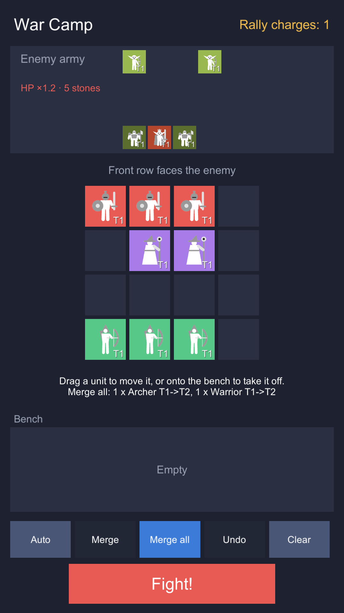
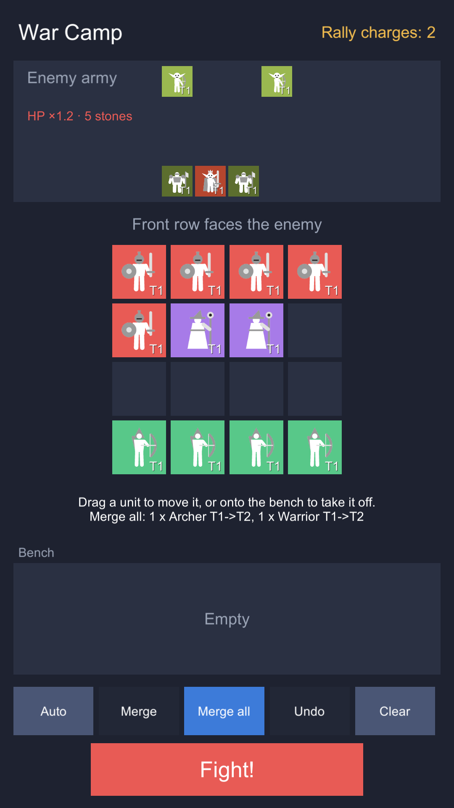
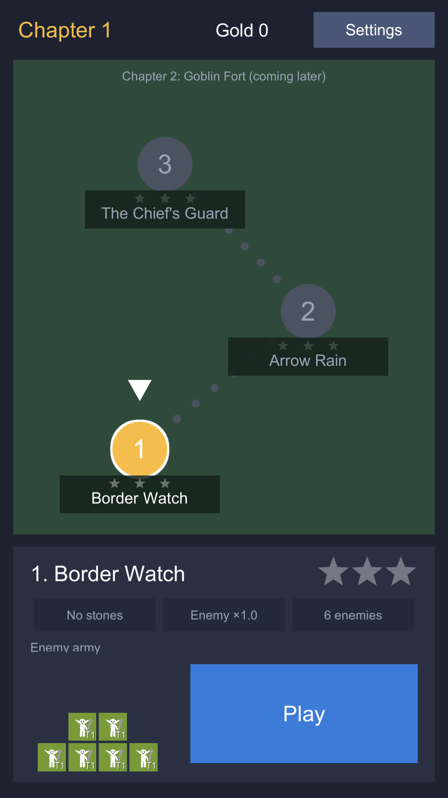

# PB-16 Final polish and balance

Owner: both · Milestone: M6 · Size: M · Branch: `feature/PB-16-final-polish` ·
Replaces: M6-03, M6-04 · Needs: PB-7 to PB-15 mostly done

## Why
The last pass before release: make every screen look like it belongs to the same
game, and check the difficulty again now that animations, tutorial and 3D change
how players experience the stages.

## Today
- Default uGUI font (LegacyRuntime), sizes picked per label in code.
- Balance from D-033 (`Tools/Balance`), playtest results from PB-5.

## Build
1. **UI polish:**
   - one font family (a free OFL font, e.g. from Google Fonts: a bold display
     font for titles + a readable sans for text; add to CREDITS.md);
     switch to TextMeshPro if not done yet;
   - a type scale (e.g. 88 / 52 / 40 / 32 px at 1080 width) and spacing scale
     (8 px grid) in one place (`Ui.cs` constants);
   - colours only from `Palette` (GDD values); check contrast of text on panels;
   - buttons: one style for primary, secondary, danger; pressed state.
2. **Playtest round 2:** same script as PB-5, 5+ new testers, on phones.
3. **Balance:** compare tester wins per stage with D-026 targets; adjust stage
   data (enemy counts, multipliers, stones, moves) and check with
   `dotnet run -c Release --project Tools/Balance 400`. Record as a decision.

## Look
Before/after screenshots of every screen in Notes (stage map, puzzle, War Camp,
battle, results, settings).

## Files
`Views/Common/Ui.cs`, `Views/Common/Palette.cs`, all screens (style only),
`Data/Stages/*.asset`, `docs/PLAYTESTS.md`, `docs/DECISIONS.md`, `docs/GDD.md`
(new numbers), CREDITS.md (font).

## In Unity
- Fonts: drag the `.ttf` into the Project window; for TextMeshPro: *Window →
  TextMeshPro → Font Asset Creator*.
- Stage numbers: select `Data/Stages/Stage_1_2.asset` and edit fields in the Inspector.

## Not in this card
New content, new mechanics.

## Done when
- [ ] One font, type scale and spacing used everywhere; before/after screenshots
- [ ] Second playtest round in PLAYTESTS.md
- [ ] Balance adjusted, `Tools/Balance` numbers and decision recorded, GDD updated

## Notes
_Findings, screenshots, numbers, decisions taken while working on this card._

2026-11-18 (Alican, with Claude) — type scale (first part of the UI polish):
- `Ui.Type` (in `Views/Common/Ui.cs`) is the one type scale: Small 30, Body 38, Action 44, Heading 52,
  Title 64, Display 90 px at 1080 wide. `Ui.Label` (and so every button caption) snaps the size it is
  given to the nearest step, so the screens now share **six sizes instead of seventeen** (28-110 px
  were in use). `Ui.Space` holds the 8 px spacing scale (8 / 16 / 32); it is defined but the screens
  do not use it yet (their layout is by anchors, not pixels).
- Before / after from the `GreyboxScreenshots` tool: the layout holds, only the text sizes moved by
  a few pixels. The two armies differ because the run is random.

  | | Before | After |
  |---|---|---|
  | War Camp |  |  |
  | Stage map |  |  |
- **Not done:** one font family (needs a font file: a free OFL font, to be downloaded and added to
  CREDITS.md first), TextMeshPro, button styles (primary / secondary / danger, pressed state),
  a contrast check, the other screens' before/after (the tool saves them all to `Logs/Screenshots/`),
  playtest round 2 and the balance pass (both need testers).
