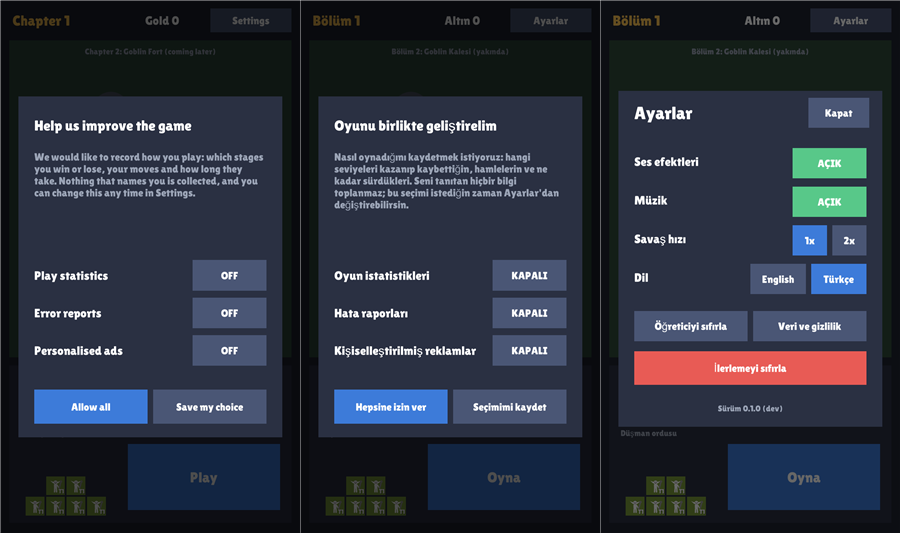

# PB-29 Analytics, remote config, crash reports, consent

Owner: Alican · Milestone: M6 · Size: M · Branch: `feature/PB-29-analytics` ·
Wave: 1 (D-045) · Needs: — (the online services part needs an account)

## Why
After the playtests we need to know where real players get stuck and how often they
retry, without asking them. Remote config changes moves and enemy strength without a
new build; crash reports tell us what breaks on phones we do not own. Turkish law
(KVKK) and GDPR need the player's consent before anything is sent.

## Today
- The playtest log writes one JSON line per finished attempt, locally
  ([PlaytestLog](../../Assets/_Project/Scripts/Flow/PlaytestLog.cs),
  [StageAttempt](../../Assets/_Project/Scripts/Logic/Flow/StageAttempt.cs), D-037); off in
  store builds (PB-17).
- Settings live in `settings.json` ([GameSettings](../../Assets/_Project/Scripts/Logic/Progression/GameSettings.cs), D-039).
- Stage numbers come from the stage assets only.

## Build
1. **Consent** (works without any service): `GameSettings` gets consent fields (analytics,
   crash reports, personalised ads) and the version of the consent text; a first-launch
   consent panel; the same switches in Settings. Tests for the defaults and migration.
2. **Event layer:** an `IAnalytics` interface in Flow with the game's events
   (stage started / won / lost with moves, time, stars, Rally used, merges; tutorial
   skipped; settings changed). A local sink writes them to a file in development builds;
   nothing is sent without consent. Events are built in Logic from `StageAttempt` (tested).
3. **Remote config:** `IRemoteConfig` with local defaults from the stage assets; a stage's
   moves and enemy multipliers can be overridden by key. Tests that overrides apply and
   that a missing key keeps the asset value.
4. **Online services** (after Alican opens the account; decision recorded): Unity Gaming
   Services Analytics + Remote Config + Cloud Diagnostics, or Firebase. Only the sink and
   the config source change.
5. Privacy text and the store's data safety form (list of what is collected).

## Look
Mockup: [growth screens, PB-29](https://claude.ai/artifact/PgA4zDSKLCXPzAjwZBPsLH#pb-29).

## Files
`Scripts/Logic/Progression/GameSettings.cs`, `Scripts/Logic/Flow/` (events),
`Scripts/Flow/` (IAnalytics, IRemoteConfig, sinks), `Views/Menus/` (consent panel,
SettingsPanel), `docs/DECISIONS.md`, `docs/SETUP.md` (service setup).

## In Unity
Services (step 4): *Edit → Project Settings → Services*, link the project to the
organisation, then install the packages from *Window → Package Manager*.

## Not in this card
Ads (PB-30), cloud save (PB-31).

## Done when
- [x] Consent panel on first launch and switches in Settings; saved and tested
- [x] Event layer with a local sink; events built in Logic with tests
- [x] Remote config overrides with tests
- [ ] Online services connected (needs the account) and events visible on their dashboard
- [x] Data safety list written

## Notes
_Findings, screenshots, numbers, decisions taken while working on this card._

2026-11-18 (Alican, with Claude) — everything that needs no account, decision D-047:
- **Consent** (`Logic/Analytics/Consent`, `Views/Menus/ConsentPanel`): asked over the stage map on the first
  launch; three switches (play statistics, error reports, personalised ads) start **off** (no pre-ticked
  boxes), "Allow all" / "Save my choice". Stored in `settings.json` with the consent text version; a newer
  version asks again. Settings → **Data and privacy** opens it with the saved answer. The settings panel's
  own copy can no longer undo a newer consent answer (`GameApp.ApplySettings` keeps the consent fields;
  tested). Built step 1 differently: the consent fields live on `GameSettings` itself, and the "text
  version" is `Consent.CurrentVersion` in code.
- **Events** (`GameEvents`): app_started, stage_started, stage_won / stage_lost, tutorial_skipped,
  setting_changed. No formation, session id or free text leaves the local playtest log.
  `AnalyticsHub` drops every event without consent; the only sink today is `analytics-log.jsonl`
  next to the save file in tester builds (editor, Windows playtest, Android development).
- **Error reports** (`ErrorReporter`): exceptions only, message + first stack line + version, 20 per
  session, to `error-log.jsonl`, only with consent.
- **Remote config** (`RemoteConfig`, `StageTuning`): `stage.<id>.moves | stones | enemy_hp | enemy_damage`,
  applied when a run starts, out-of-range values ignored. Tester builds read `remote-config.txt` next to
  the save file, e.g. `stage.stage_1_3.moves = 14`. The stage map card still shows the asset values.
- **Data safety list:** `docs/PRIVACY.md` (what, when, where, and what is still missing).
- Tests: logic 200/200 (dotnet), Unity EditMode 231/231 (5 new file tests in `EditModeFlow`), PlayMode
  25 passed + 3 explicit skipped (3 new `ConsentFlowTests`), 0 failed. The screenshot run captures the
  question on its own (`1-consent.png`) and keeps it off the other screens.

  
- **Left (owner):** pick the service (Unity Gaming Services or Firebase), open the account, then a sink
  for events and errors and a config source replace the local files; a public privacy policy URL for
  Google Play (from PRIVACY.md).
