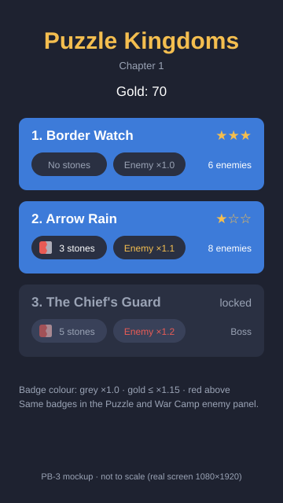
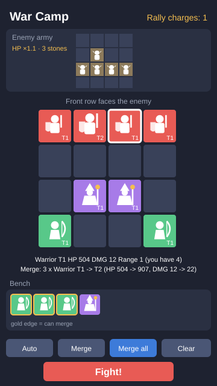
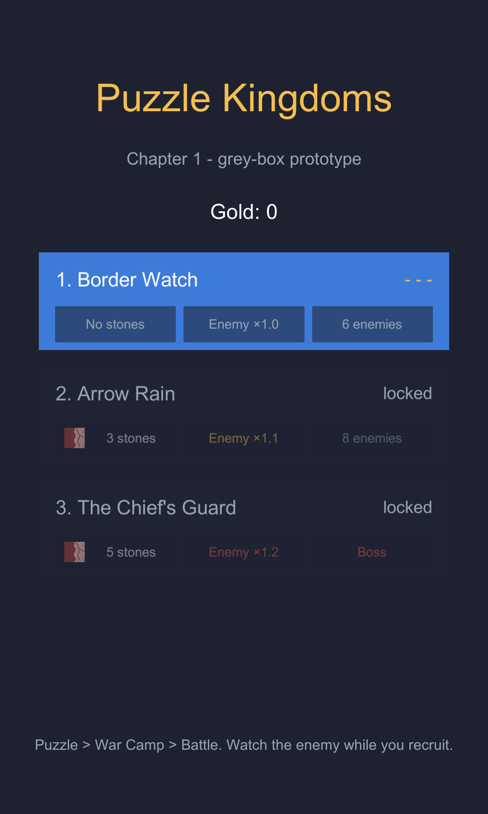
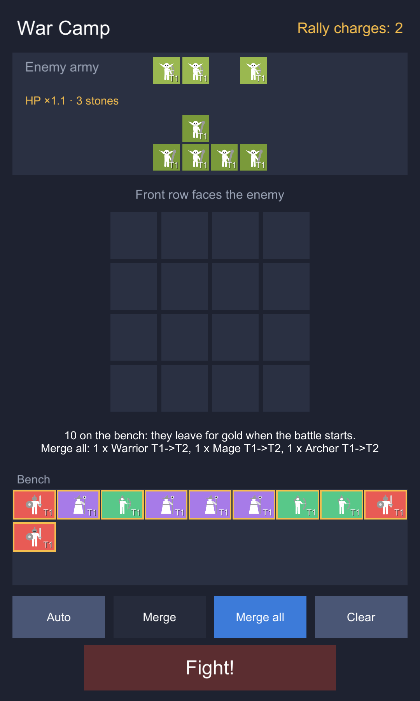
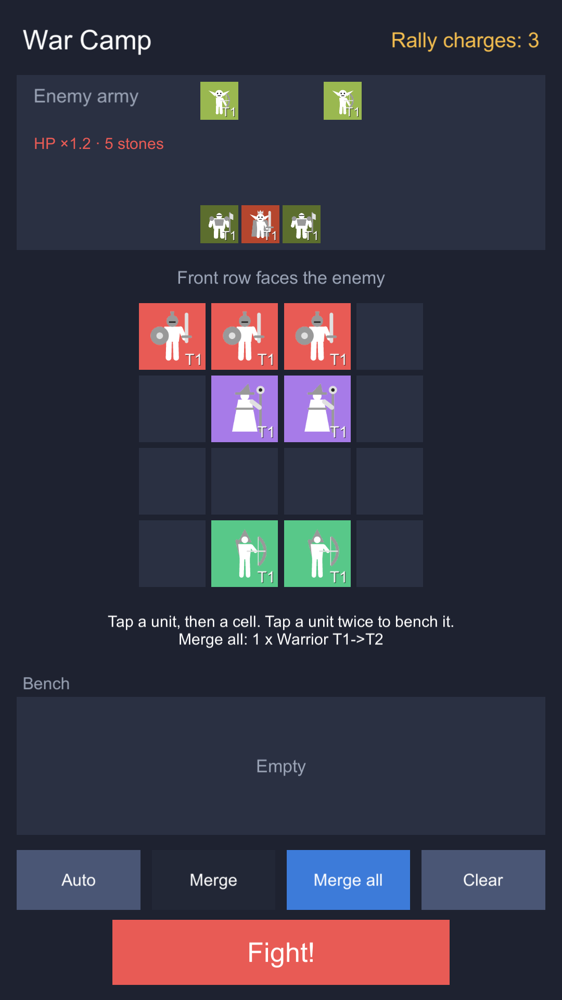

# PB-3 War Camp and stage select show what the game knows

Owner: — (suggested Emir) · Milestone: M1 · Size: S · Branch: `feature/PB-3-war-camp-visuals` ·
Replaces: M1-09, M1-10

## Why
Two things the game already knows are not on screen:
1. **How hard a stage is.** Stages get stone gems and stronger enemies (D-032,
   D-033), but the stage list only shows the name and stars. Players walk into
   1-3 not knowing the enemy is 20% tougher. Pillar 2 of the GDD (readable cause
   and effect) needs this visible *before* the fight.
2. **What a unit is.** The battle draws a warrior as a warrior (D-029), but the
   War Camp still shows letters ("W1", "A1"). The place where the player plans
   the army is the one place that has no pictures.

View-only card: no rule changes, no new data.

## Today
- Stage data: `StageDef.StoneGems`, `StageDef.EnemyHpMultiplier`,
  `StageDef.EnemyDamageMultiplier`, enemy list
  ([StageDef.cs](../../Assets/_Project/Scripts/Logic/Stages/StageDef.cs)). Values:
  1-1 none/×1.0, 1-2 3/×1.1, 1-3 5/×1.2.
- Stage list: [StageSelectScreen.cs](../../Assets/_Project/Scripts/Views/Menus/StageSelectScreen.cs)
  builds one button per stage with name + stars.
- Enemy preview: `FormationGridView` in the top panel of
  [PuzzleScreen.cs](../../Assets/_Project/Scripts/Views/Puzzle/PuzzleScreen.cs) and
  [WarCampScreen.cs](../../Assets/_Project/Scripts/Views/WarCamp/WarCampScreen.cs).
- Silhouettes: `UnitSilhouettes.Get(UnitLook)` returns a white sprite;
  `Palette.LookFor(def)` gives the look for a unit; `BattleScreen.CreateUnit`
  already uses both (copy that).
- Letters come from `Palette.Tag(unit)` in
  [FormationGridView.cs](../../Assets/_Project/Scripts/Views/Common/FormationGridView.cs)
  (`SetCell`) and in `WarCampScreen.RebuildBench`.

## Build
1. **Difficulty badges** (small helper, e.g. `StageBadges` in `Views/Common`):
   - "No stones" / "N stones" with a small half-stone gem icon
     (`GemShapes.GetStoneHalf` on top of a red square gem sprite).
   - "Enemy ×1.1" from `EnemyHpMultiplier`; colour grey at ×1.0, gold up to
     ×1.15, red above. Show the damage multiplier only when it is not 1.0.
   - Enemy count ("8 enemies"), "Boss" when the stage has a Chief-class enemy
     (simplest: the biggest HP enemy has `look` = Chief; or just count).
2. **Stage select:** make each stage button taller and put the badges in a
   second row under the name (see mockup). Locked stages show badges dimmed.
3. **Enemy panel:** one line "HP ×1.1 · 3 stones" under "Enemy army" on the
   puzzle screen and the War Camp.
4. **Silhouettes in the War Camp:**
   - `FormationGridView.SetCell`: the cell keeps its class colour, add a child
     `Image` with `UnitSilhouettes.Get(Palette.LookFor(unit.Def))`, white,
     `preserveAspect = true`; the label shrinks to "T1" in the lower-right corner.
   - Tier 2/3 silhouette slightly larger (1.0 / 1.1 / 1.2), like the battle.
   - Bench buttons: same silhouette + tier, keep the gold merge edge and the
     white selection edge.
   - Enemy preview grids get enemy silhouettes the same way.
5. Check at 1080×1920 and at a short screen (e.g. 1080×1800) that nothing overlaps.

## Look
Stage select with badges:

War Camp with silhouettes (the gold edge marks units that can merge; white edge =
selected):

Prototype assets: none needed; everything is drawn in code already. If you want
icons for the badges instead of the drawn gem, the **Kenney Game Icons** pack
(kenney.nl/assets/game-icons, CC0) has a skull and a shield; add it to CREDITS.md first.

## Files
`Views/Menus/StageSelectScreen.cs`, `Views/Common/FormationGridView.cs`,
`Views/WarCamp/WarCampScreen.cs`, `Views/Puzzle/PuzzleScreen.cs`, new
`Views/Common/StageBadges.cs` (+ its `.meta`, Unity creates it).
Update STRUCTURE.md for the new file.

## In Unity
Nothing to set up: all screens are built from code when Play starts. Change
code, switch back to Unity, wait for the spinner in the bottom-right corner to
finish, press Play. The `.meta` file for a new `.cs` file appears after Unity
compiles it; commit both.

## Not in this card
New art, animations (PB-9), drag and drop (PB-9), changing difficulty values.

## Done when
- [x] Stage select shows stones, enemy HP × and enemy count/boss for all 3 stages
- [x] Puzzle and War Camp enemy panels show the same line
- [x] War Camp grid, bench and enemy preview show silhouettes, no letters except the tier
- [x] Looks right at 1080×1920 and one shorter screen; screenshot in Notes
- [x] No logic file changed; `dotnet test Tools/LogicTests` still green

## Notes
2026-11-16 (Emir, with Claude):
- `StageBadges` builds the badges (stones with a half-stone gem icon, "Enemy ×1.1"
  grey/gold/red, damage multiplier only when not 1.0, "N enemies" or "Boss" when a
  Chief-look enemy is in the army) and the enemy panel line ("HP ×1.2 · 5 stones").
- `UnitSilhouettes.AddIcon` / `AddTierLabel` / `FitIcon` are shared by the
  formation grid and the bench; tier 2/3 icons are about 10%/20% larger. The tier
  label shrinks to fit the small enemy preview cells.
- Stage buttons are two rows: name and stars, then the badges; locked stages are dimmed.
- Checked with the `GreyboxScreenshots` PlayMode test, which now also renders
  1080×1800 (`CaptureShortScreen`, units left on the bench so the bench shows):

  
  
  
- Not played by hand in the editor; the screenshots come from the same code path.
