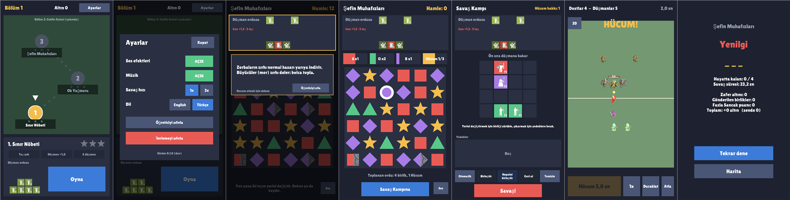

# PB-32 Turkish and English

Owner: Alican · Milestone: M6 · Size: M · Branch: `feature/PB-32-localization` ·
Wave: 1 (D-045) · Needs: —

## Why
Our testers are Turkish and the store page needs two languages. Today every text is
English and written straight into the screen code, so a translation means touching
every screen; one string table fixes that for good.

## Today
- Texts are literals in the screens ([StageMapScreen](../../Assets/_Project/Scripts/Views/Menus/StageMapScreen.cs),
  [PuzzleScreen](../../Assets/_Project/Scripts/Views/Puzzle/PuzzleScreen.cs),
  [WarCampScreen](../../Assets/_Project/Scripts/Views/WarCamp/WarCampScreen.cs),
  [BattleScreen](../../Assets/_Project/Scripts/Views/Battle/BattleScreen.cs),
  [ResultsScreen](../../Assets/_Project/Scripts/Views/Menus/ResultsScreen.cs),
  [SettingsPanel](../../Assets/_Project/Scripts/Views/Menus/SettingsPanel.cs),
  [TutorialOverlay](../../Assets/_Project/Scripts/Views/Common/TutorialOverlay.cs)),
  stage names and tutorial prompts are on the stage assets (D-040), unit names on the unit assets.
- Settings in `settings.json` ([GameSettings](../../Assets/_Project/Scripts/Logic/Progression/GameSettings.cs), D-039).
- Font: Lilita One (D-044).

## Build
1. **Logic:** `Strings` table (key → text per language), `Language` (English, Turkish),
   formatting with arguments (`{0}`), fallback to English then to the key. Tests:
   lookup, fallback, arguments, every key has both languages.
2. **Data:** the table as a text asset in the project (one file per language, simple
   `key = text` lines so a translator can edit it without Unity); stage names, tutorial
   prompts and unit names become keys.
3. **Settings:** `language` in `GameSettings` (default: the phone's language if Turkish,
   else English); a language switch in Settings that redraws the current screen.
4. **Screens:** every literal replaced by a lookup.
5. **Checks:** a test that the font draws every character the Turkish table uses
   (ç ğ ı İ ö ş ü); screenshots of every screen in both languages; long Turkish words
   must not overflow buttons.

## Look
Mockup: [growth screens, PB-32](https://claude.ai/artifact/PgA4zDSKLCXPzAjwZBPsLH#pb-32).

## Files
`Scripts/Logic/Localization/` (new), `Scripts/Logic/Progression/GameSettings.cs`,
`Resources/Strings/` (tables), all screens in `Views/`, `Data/Stages/*`, `Data/Units/*`,
`Tests/EditMode/Localization/`, `docs/CONVENTIONS.md` (how to add a text), `docs/STRUCTURE.md`.

## In Unity
The tables are plain text files under `Assets/_Project/Resources/Strings/`; edit them in
any editor. To see Turkish in the editor: Settings → Language → Türkçe.

## Not in this card
More languages, store listing texts (PB-17 / release).

## Done when
- [x] String table in Logic with tests; every key in both languages (tested)
- [x] Language saved in settings, switch in Settings, phone language as default
- [x] No English literal left in the screens; stage, tutorial and unit texts translated
- [x] Font covers the Turkish characters (tested); screenshots of every screen in Turkish in Notes

## Notes
_Findings, screenshots, numbers, decisions taken while working on this card._

2026-11-18 (Alican, with Claude) — done, decision D-046:
- **Not as planned in Build step 2:** instead of keys and two `key = text` files, the English text is
  the key (`Loc.T("Merge all")`) and there is one Turkish file, `Resources/Strings/tr.txt`
  (`English<TAB>Türkçe`, 109 rows). English needs no table, button objects keep their English names
  (tests and tutorial targets find them by name), and stage / tutorial / unit texts on the assets did
  not change: their English text is the key.
- Logic: `Language`, `Languages` (codes, phone default), `Localizer` (table, fallback, `{0}` formatting,
  "2,5" in Turkish). Views: `Loc` (the current language), `Ui.Button` / `Ui.SetCaption` translate their
  captions. `GameSettings.language` ("" = follow the phone); Settings → Language (English / Türkçe)
  saves and redraws the map and the panel at once. `GameApp.UseLanguage` lets tests fix the language.
- Checks: `TurkishTableTests` (also in `dotnet test`) — the table reads cleanly, placeholders match,
  every literal given to `Loc.T` / `Loc.F` / `Ui.Button` / `Ui.SetCaption` in Views and Flow and every
  stage / unit / tutorial text in the assets has a Turkish row, and no label or `.text` is set from a
  plain English literal (that last check found "RALLY!" and the puzzle title, both fixed). Removing two
  rows on purpose made the test name them. `LocalizationTests` (PlayMode): Lilita One draws every
  character of the table (ç ğ ı İ ö ş ü included); `SettingsTests`: the language switch.
- Words: Rally = **Hücum**, tier stays T1/T2/T3, class tags W / A / M = S / O / B.
- Tests: logic 186/186 (dotnet), Unity EditMode 212/212, PlayMode 22 passed + 3 explicit skipped, 0 failed.
- Screenshots: `PK_SCREENSHOT_LANG=tr` runs `GreyboxScreenshots` in Turkish into `Logs/Screenshots/tr/`.
  Long Turkish captions wrap inside their buttons ("Hepsini birleştir" in the War Camp).

  
- Open for later: a native speaker's read of the texts in a playtest; more languages would need a
  plural rule (Turkish has none after numbers, so "{0} taş" is enough today).
