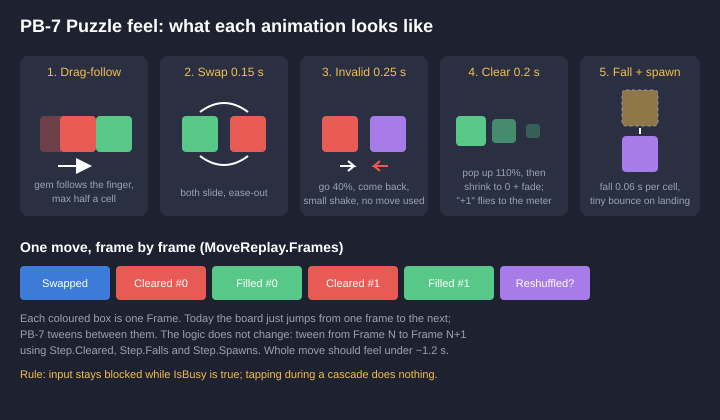
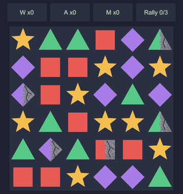

# PB-7 Puzzle feel: input and animations

Owner: Emir · Milestone: M2 · Size: L · Branch: `feature/PB-7-puzzle-feel` ·
Replaces: M2-01, M2-02, M2-05

## Why
Match-3 lives or dies on feel. Today the board *jumps* from one state to the
next: the swap, the clear, the fall and the new gems all happen at once, so the
player cannot see what their move did, and cascades ("Bonus!") are hard to read.
Every competitor animates every gem; without it the game reads as broken, not as
a prototype.

## Today
- Input: tap a gem, then a neighbour; or swipe
  ([PuzzleScreen.cs](../../Assets/_Project/Scripts/Views/Puzzle/PuzzleScreen.cs)
  `OnCellPressed`, `OnCellSwiped`; cells in
  [GemCell.cs](../../Assets/_Project/Scripts/Views/Puzzle/GemCell.cs)).
- "Compute, then animate" is ready: `BoardModel.TrySwap` returns a `MoveResult`;
  `MoveReplay.Frames(...)` turns it into frames: `Swapped`, then per cascade step
  `Cleared` and `Filled`, then maybe `Reshuffled`
  ([MoveReplay.cs](../../Assets/_Project/Scripts/Logic/Puzzle/MoveReplay.cs)).
  Each step lists `Cleared` cells, `Falls` (from → to), `Spawns`.
- `PuzzleScreen.Animate` shows the frames one after another with a short pause;
  `IsBusy` blocks input meanwhile. `Reject` handles an invalid swap.
- A 5-second idle hint exists (`HintDelaySeconds`).

## Build
1. **Tween helper** in `Views/Common` (e.g. `Tween.cs`): coroutine-based
   move/scale/fade over time with an ease-out curve. Own code, no package needed.
   (DOTween is the common alternative; free, but add it to CREDITS.md first and
   agree on it in the check-in.)
2. **Gem sprites move instead of cells re-colouring:** keep one `GemCell` per
   cell as a fixed slot, but animate a child "gem" image. Simplest approach: for
   a frame transition, create temporary gem images at the old positions, tween
   them, then call the normal `Render` with the new frame and destroy them.
3. Per frame kind (durations are starting values; put them as constants at the
   top of the file):
   - **Swapped:** both gems slide to each other's cell, 0.15 s.
   - **Cleared:** cleared gems pop to 110% then shrink to 0 and fade, 0.2 s; a
     small "+1" in the gem colour flies to its meter (optional, nice).
   - **Filled:** falling gems move down 0.06 s per cell with a tiny bounce on
     landing; spawned gems start above the board and fall in.
   - **Reshuffled:** every gem flies to its new cell at the same time, 0.4 s.
4. **Invalid swap:** both gems move 40% towards each other and back, plus a
   short horizontal shake, 0.25 s. No move is used.
5. **Swipe feel:** a swipe counts after the finger moved 30% of a cell
   (tune it). While dragging, the gem follows the finger up to half a cell in
   the drag direction; releasing early snaps it back.
6. **Hint polish:** after 5 s idle the two hint gems gently pulse (scale
   100-108%) instead of a static mark; any touch stops it.
7. Keep a whole move with one cascade under ~1.2 s. Add a speed constant so
   it can be tuned in one place.

## Look

Reference: watch 30 seconds of any popular match-3 with slow motion (screen
record, play at 0.25×); copy timings, not art.

Prototype assets: gems stay code-drawn (`GemShapes`). If you want particles for
the clear, **Kenney Particle Pack** (kenney.nl/assets/particle-pack, CC0) has
small stars and sparks; add to CREDITS.md first.

## Files
`Views/Puzzle/PuzzleScreen.cs`, `Views/Puzzle/GemCell.cs`, new
`Views/Common/Tween.cs`. **No change in `Logic/`**: if you think you need one,
talk first (it would need tests).

## In Unity
- To see animation slowly: in Play mode open *Edit → Project Settings → Time*
  and set *Time Scale* to 0.2 (set it back to 1 afterwards, it is saved!).
- Touch on PC: the mouse simulates one finger. To test real swipes, use the
  phone build from PB-1 or *Unity Remote 5* (free app, *Edit → Project Settings →
  Editor → Device*).

## Not in this card
Sounds, screen shake, special-gem explosions (PB-8). Any rule change.

## Done when
- [x] Swap, invalid swap, clear, fall, spawn and reshuffle are animated
- [x] Input is blocked while animating; no gem ends on a wrong cell (play 20 moves, compare with the logic: the board after the animation equals `BoardModel.ToGrid`)
- [ ] Swipe threshold and drag-follow feel right on a phone (PB-1 build)
- [x] Idle hint pulses
- [x] Short screen recording (GIF/MP4) linked in Notes

## Notes
2026-11-16 (Emir, with Claude):
- Every board cell is now a fixed slot (takes the touches, never moves) with a
  child gem image. An animation renders the next `MoveReplay` frame first and then
  moves the gem images from where they were back into their slots, so the board
  can never end on a wrong cell: the last tween step always lands on zero.
- `Views/Common/Tween.cs`: `Run(seconds, step)`, `Move`, and ease curves. Own code,
  no package. Uses scaled time, so `Time.timeScale` speeds tests up.
- Timings are constants at the top of `PuzzleScreen` (`DurationScale` changes them
  all): swap 0.15 s, clear 0.2 s (grow to 110 %, then shrink and fade), fall
  0.06 s per cell plus a 0.08 s landing bounce, reshuffle 0.4 s (each gem flies in
  from an old cell of the same colour; the logic only reports the new board),
  invalid swap 0.25 s (lean 40 % towards each other, small sideways shake, red
  outline). A move with one cascade takes about 1 s.
- Spawned gems start `DropDistance` cells above the board; a `RectMask2D` on the
  board hides them until they enter.
- Swipe: counts after 30 % of a cell (`GemCell.SwipeShare`); before that the gem
  follows the finger on one axis; letting go snaps it back in 0.1 s.
- Hint: after 5 s idle the two hint gems breathe between 100 % and 108 %; any
  touch or drag stops it.
- Test: `GreyboxLoopTests.PuzzleBoardMatchesLogicAfterEveryAnimation` plays an
  invalid swap and 20 moves on 1-3 (stones) and checks after each that the shown
  gems, special gems and stones equal `BoardModel` and every gem image is back in
  its cell at full size; it also checks that a second swap during an animation is
  refused and that an invalid swap uses no move.
- Recording: `GreyboxScreenshots.RecordMoveAnimation` (explicit) writes 30 fps
  frames to `Logs/Screenshots/anim/`; turned into a GIF with Pillow:

  
- Still open: the swipe threshold and drag-follow have not been tried on a phone
  (needs the PB-1 install).
