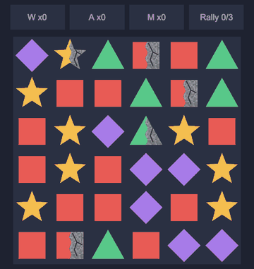

# PB-8 Puzzle feedback: effects and sound

Owner: Emir · Milestone: M2 · Size: M · Branch: `feature/PB-8-puzzle-feedback` ·
Replaces: M2-03, M2-04, M2-06 · Best after PB-7

## Why
The special matches (Blast, Prism) and stone gems are the most exciting moments
on the board, but today they look like any other clear: the cells just change.
Players do not notice that their 2×2 made a Blast or that a stone cracked.
Sound and a little shake make big moves feel big and teach the rules without text.

## Today
- Labels exist: "Bonus! xN" for cascades, "Blast!", "Prism!", "Stone cracked!"
  (`PuzzleScreen.SpecialLabel`).
- Each `CascadeStep` tells you what happened: `Created` (new specials),
  `Triggers` (specials that went off), `Cracked` (stones broken), `Cleared`
  ([MoveResult.cs](../../Assets/_Project/Scripts/Logic/Puzzle/MoveResult.cs)).
- No audio at all in the project.

## Build
1. **Audio setup:** one `AudioSource` on a `Sfx` helper in `Views/Common`
   (`Sfx.Play(clip, pitch)`); clips referenced from a small `SoundBank`
   ScriptableObject in `Data/` (data, not hardcoded). Music on a second source,
   looping, low volume.
2. **Sounds** (placeholder):
   - match/clear: one "pop", pitch rises with the cascade index
     (1.0, 1.08, 1.16, … capped);
   - Blast created: whoosh; Blast goes off: thump;
   - Prism created: chime; Prism goes off: sweep;
   - stone cracks: rock crack; invalid swap: soft "nope";
   - meter fills a unit: a short "ding"; Rally charge: horn.
3. **Effects:**
   - Blast goes off: an expanding ring over the 3×3 area + 0.15 s screen shake
     (shake the board root, small: 8-12 px).
   - Prism goes off: a beam/line from the Prism to each gem it clears, then
     those clear; bigger shake.
   - Stone cracks: 4-6 grey chips fly off and fade; the stone half disappears.
   - Special created: the new special gem flashes white once.
4. Global mute toggle (stored later in Settings, PB-14; for now a boolean).

## Look
Ring for Blast and sparkle for Prism exist as gem marks; effects reuse their
colours. Timing reference: same as PB-7, effects ≤ 0.3 s so cascades do not drag.

Prototype assets (all free, check the license page; add to CREDITS.md first):
- **Kenney audio packs** (kenney.nl/assets, CC0): *Interface Sounds*,
  *Impact Sounds*, *Casino Audio* (chimes), *RPG Audio* (horn).
- **Kenney Particle Pack** (CC0) for ring, sparks, chips.
- Music: **Kevin MacLeod / incompetech.com** (CC BY: needs attribution in the
  game credits) or CC0 tracks from **OpenGameArt.org** (filter by license).

## Files
New `Views/Common/Sfx.cs`, `Data/SoundBank.cs` (ScriptableObject) + asset,
`Views/Puzzle/PuzzleScreen.cs`, sound files under `Assets/ThirdParty/<pack>/`
(not `_Project`). CREDITS.md, STRUCTURE.md.

## In Unity
- Drop `.wav`/`.ogg` files into the folder in the Project window; Unity imports
  them. For short SFX set *Load Type: Decompress On Load* in the Inspector.
- Create the SoundBank: right-click in the Project window → *Create → Puzzle
  Kingdoms → Sound Bank* (after you add the `CreateAssetMenu` attribute), then
  drag clips into its fields.

## Not in this card
Battle sounds (PB-12). Final audio (post-M6).

## Done when
- [x] Every event in Build step 2 makes a sound; cascade pitch rises
- [x] Blast, Prism and stone crack have visible effects; shake on Blast/Prism
- [x] Mute works
- [x] All assets in CREDITS.md with license; recording in Notes

## Notes
2026-11-16 (Emir, with Claude):
- **Sounds are generated, not downloaded (D-036).** `Puzzle Kingdoms → Generate
  Placeholder Sounds` (`Scripts/Editor/PlaceholderSounds.cs`) synthesizes ten
  .wav files into `Audio/Placeholder/`, fills `Data/SoundBank.asset` and links it
  from `GameContent`. Same files on every run. Nothing third-party, so CREDITS.md
  only notes that. To use real sounds: import them and drag them into the
  SoundBank fields; no code change.
- Clips: match pop 0.11 s (falling sine), Blast created whoosh 0.35 s, Blast fired
  thump 0.32 s, Prism created chime 0.6 s, Prism fired sweep 0.38 s, stone crack
  0.22 s, invalid swap "uh-uh" 0.24 s, unit ding 0.4 s, Rally horn 0.7 s, music
  8 s loop (Am-F-C-G arpeggio, 120 bpm) at volume 0.25.
- `Views/Common/Sfx.cs`: 8 voices (each keeps its own pitch), a looping music
  source, adds an AudioListener if the scene has none. `GameApp` sets it up.
- Cascade pitch: 1.0 + 0.08 per wave, capped at 1.4 (`SoundBank` fields).
- `Views/Puzzle/BoardEffects.cs` on a layer over the board: Blast ring grows from
  one cell to the 3×3 area (0.28 s) + 10 px shake 0.15 s; Prism beams to every
  gem it clears (0.3 s) + 16 px shake 0.2 s; 5 grey chips per cracked stone
  (0.3 s); new special gem flashes white (0.25 s). Effects run on the layer's own
  coroutines and remove themselves.
- Ding when a meter gave a unit this move, horn when it gave a Rally charge
  (played when the move ends, together with the meter update).
- Mute: "Sound"/"Muted" button bottom right of the puzzle screen; a static flag
  for the session (saved in Settings, PB-14).
- Tests: `GameDataTests.SoundBankHasEveryClip`; the PlayMode board test now also
  checks that an invalid swap makes a sound, that nothing plays while muted, that
  every move at least pops and that all effects clean up.
- Recording (no sound in a GIF): moves with a stone crack, then a showcase of the
  Blast ring, Prism beams, chips and the special flash:

  
- **Not done: nobody has listened yet.** The waveforms were checked as pictures
  only; the listening check is in the PB-2 play checklist.
