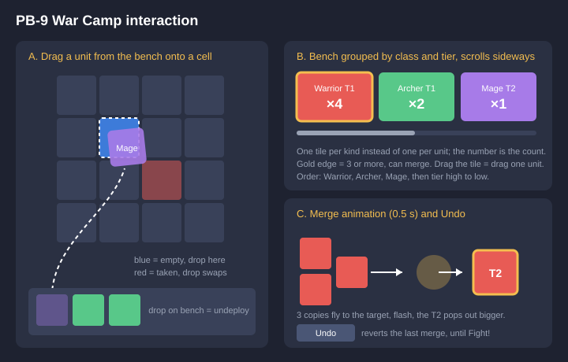
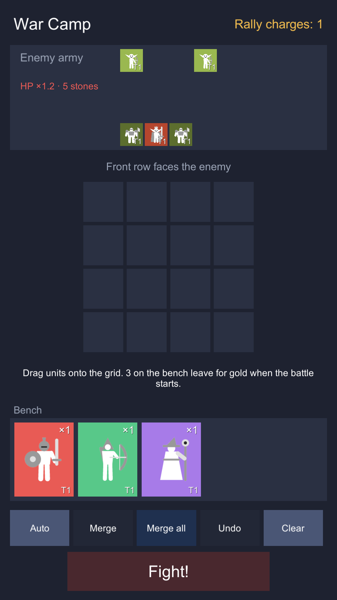

# PB-9 War Camp interaction: drag and drop, bench, merge

Owner: Alican · Milestone: M3 · Size: L ·
Branch: `feature/PB-9-war-camp-interaction` · Replaces: M3-01, M3-02, M3-03 ·
Best after PB-3

## Why
The War Camp is where the player makes the tactical choice the game is about.
Today it works by "tap a unit, tap a cell", which testers will not discover
without being told, and the bench shows one button per unit: after a good
puzzle that is 15+ identical-looking buttons. Merging just makes units vanish.
Dragging is what every phone player tries first.

## Today
- [WarCampScreen.cs](../../Assets/_Project/Scripts/Views/WarCamp/WarCampScreen.cs):
  tap-select flow (`OnCellClicked`, `OnBenchClicked`), buttons Auto / Merge /
  Merge all / Clear / Fight!, info text with merge preview.
- Logic in [Roster.cs](../../Assets/_Project/Scripts/Logic/Army/Roster.cs):
  `Deploy(unit, cell)` (moves or swaps), `Undeploy(cell)`, `Merge(unit)`,
  `MergeAll()`, `PlanMergeAll()`, `CanMerge`, event `Changed`.
- No undo.

## Build
1. **Drag and drop** (uGUI `IBeginDragHandler`, `IDragHandler`, `IEndDragHandler`):
   - drag from a bench tile or a deployed cell; a semi-transparent copy follows
     the finger, slightly tilted;
   - hovered cell highlights: blue = empty, red = occupied (drop swaps);
   - drop on a cell → `Roster.Deploy`; drop on the bench → `Roster.Undeploy`;
     drop anywhere else → snaps back;
   - keep tap-select working as a fallback (accessibility, testers who tap).
2. **Grouped bench:** one tile per (class, tier) with "×N"; order Warrior,
   Archer, Mage, then tier high → low; scrolls sideways (`ScrollRect`) if it
   overflows; gold edge when N ≥ 3 (can merge). Dragging a tile drags one unit.
3. **Merge animation:** when Merge / Merge all runs, the consumed units fly
   into the target, a flash, the new unit pops in 120% → 100%, 0.5 s. For Merge
   all, play merges one after another quickly (0.15 s each).
4. **Undo (logic, needs tests):** `Roster` keeps a snapshot stack of
   (bench, formation) before each Merge / MergeAll; `Roster.Undo()` restores
   the last; cleared when the battle starts. Tests in
   `Tests/EditMode/Army/RosterUndoTests.cs`: undo after merge restores exact
   units and cells; undo after merge-all; undo with nothing to undo is a no-op.
   Button "Undo" next to Merge all.

## Look

Prototype assets: silhouettes from PB-3. For panels and buttons with rounded
frames, **Kenney UI Pack** (kenney.nl/assets/ui-pack, CC0) works well as 9-slice
sprites; add to CREDITS.md first.

## Files
`Views/WarCamp/WarCampScreen.cs`, new `Views/WarCamp/DraggableUnit.cs` and
`Views/WarCamp/BenchView.cs`, `Views/Common/FormationGridView.cs`;
`Logic/Army/Roster.cs` + tests for Undo. DECISIONS.md entry for undo
(when it is cleared).

## In Unity
- Drag events need an `EventSystem` in the scene (it exists; the Main scene
  builder adds it) and a `Graphic` with *Raycast Target* on.
- The ghost image must have *Raycast Target* **off**, or it blocks the drop target.
- Test with the mouse in the editor, then on the phone.

## Not in this card
3D battle, unit stats rework, new classes.

## Done when
- [x] Bench → cell, cell → cell (swap), cell → bench all work by dragging; tap still works
- [x] Bench is grouped with counts and scrolls
- [x] Merge and Merge all animate
- [x] Undo works, has tests, `dotnet test Tools/LogicTests` green; DECISIONS.md updated
- [ ] Played on the phone; recording in Notes

## Notes
2026-11-17 (Alican, with Claude):
- **Undo (D-038):** `Roster` saves bench + formation before every Merge and every
  Merge all (one step for the whole Merge all); `Undo()` puts the same unit
  objects back on the same cells, also taking back moves made after that merge.
  Deploy moves are not undo steps (dragging already reverses them).
  `StageRun.StartBattle` clears it. Tests: `RosterUndoTests` (9),
  `StageRunTests.StartingTheBattleClearsUndo`.
- **Grouped bench:** the grouping rule is logic (`BenchGroup.FromBench`, tests in
  `BenchGroupTests`): classes in gem order (Warrior, Archer, Mage), then tier high
  to low. `Views/WarCamp/BenchView.cs` draws one 190-unit tile per group with "×N"
  in a sideways `ScrollRect`; gold edge = can merge, white edge = selected. Five
  tiles fit on a 9:16 phone.
- **Drag and drop:** `Views/WarCamp/DraggableUnit.cs` on every bench tile and grid
  cell. The ghost is a tilted, 80 % copy under a `CanvasGroup` with
  *blocksRaycasts* off. Hover: blue outline = empty cell, red = taken (drop swaps,
  or sends the occupant to the bench when the unit comes from the bench); blue
  edge round the bench when a deployed unit can be dropped there. Anywhere else
  it snaps back in 0.15 s. A drag on a bench tile scrolls the bench instead only
  when the bench overflows and the finger moves at least twice as much sideways as
  up (`DraggableUnit.SidewaysRatio`); otherwise diagonal drags towards the grid
  were taken as scrolls. A drag never counts as a tap.
- **Merge animation:** the vanished units fly into the new unit (0.25 s), a white
  flash, the new unit pops 0 → 120 % → 100 % (0.25 s); Merge all plays the new
  units 0.15 s apart. Chained merges (T1 → T2 → T3) show as one: the T1s fly
  straight into the T3. Input waits while it plays. Constants at the top of
  `WarCampScreen`.
- **Test:** `WarCampInteractionTests` (PlayMode) plays real uGUI drag events:
  bench → cell, bench → cell, cell → occupied cell (swap), cell → bench, drop
  elsewhere (snaps back, no ghost left); tap then cell; Merge all with 13 of each
  class (animation, Undo blocked meanwhile, every tile back to full size, bench
  scrolls when it overflows, Undo restores exact units and cells).
- Bench before deploying (screenshot test, 1080×1920):

  
- Still open: try the drag feel and the scroll-vs-drag rule on a phone (PB-1
  build) and add a recording.
